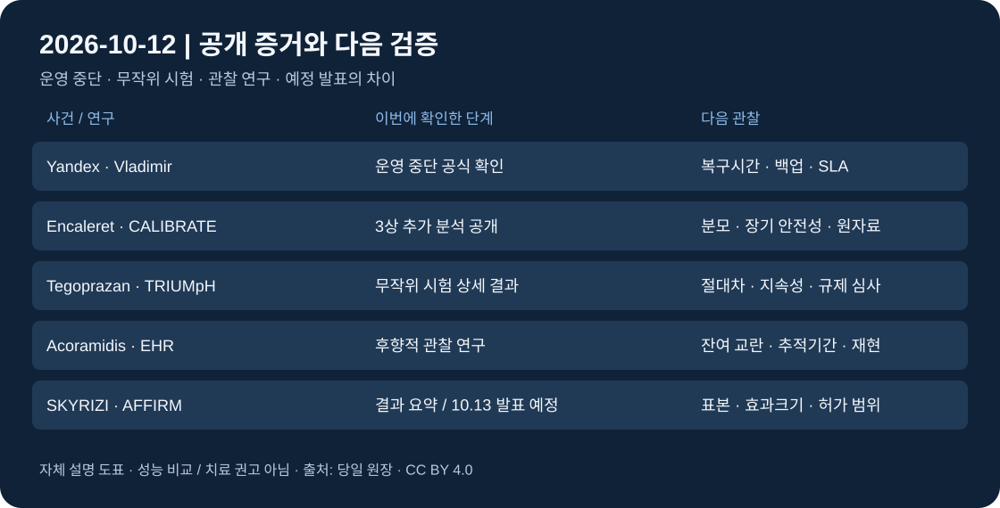

# 글로벌 테크 인텔리전스 리포트 — 2026-10-12

> **실제 실행 시작·컷오프:** 2026-10-12 08:54:49 KST / 2026-10-11 23:54:49 UTC  
> **직전 24시간:** 2026-10-11 08:54:49–2026-10-12 08:54:49 KST = 2026-10-10 23:54:49–2026-10-11 23:54:49 UTC.  
> [증거 원장](../../../sources/2026/10/2026-10-12.md) · [시각자료 명세](../../../assets/2026-10-12/README.md)

**범위:** 이번 사용자 지시의 24시간 제한을 적용했다. 저장소 정책의 미발행 공백 확장 규칙과 달리 10/9 이후 공백을 소급 보완하지 않았다. 새 공개·확인 시점과 실제 사건·실험 수행 시점을 구분한다.

*자체 설명 도표, CC BY 4.0. 실제 사건 사진이나 실측 성능 비교가 아니다.*

## 핵심 요약

**물리 인프라의 운영복원력과 생명과학의 검증 설계**가 이번 구간의 핵심이다. Yandex의 추가 데이터센터 중단은 연산·클라우드 서비스가 물리적 입지 위험에 노출됨을 보여준다. 과학 분야에서는 네 개의 서로 다른 질환·치료 연구에 새 결과가 공개됐다. 분야별 탐색 후 당일 원문·수치가 확보된 연구를 우선해 과학 4건, AI·테크 1건을 선정했다. 임상 결과는 회사가 공개한 근거이며 독립 논문 검증·규제 승인과 구분한다.

| 순위 | 새로운 발전 | 분야 | 우선순위 / 신뢰도 | 확인 단계 |
|---|---|---|---|---|
| 1 | Yandex Vladimir 데이터센터 추가 중단 공식 확인 | AI·테크 | High / High | 운영 중단, Reuters 교차확인 |
| 2 | Encaleret CALIBRATE의 골대사·환자보고 결과 공개 | 과학 | Medium-High / Medium | 3상 추가 분석·회사 발표 |
| 3 | Tegoprazan 미국 NERD 3상 상세 결과 공개 | 과학 | Medium-High / Medium | 무작위 시험 결과·회사 발표 |
| 4 | Acoramidis–tafamidis EHR 비교 연구 공개 | 과학 | Medium-High / Medium | 관찰 연구, 인과 우위 미확정 |
| 5 | SKYRIZI 피하 유도요법 AFFIRM 결과 요약 공개 | 과학 | Medium / Medium | 결과 요약, 구두 발표는 10/13 예정 |

## 1. AI·테크 — Yandex, Vladimir 데이터센터 중단을 추가 확인

### FACT
Yandex는 기존 10/9 공지의 **10/11 갱신**에서 Vladimir 데이터센터가 야간 공격을 받아 **운영을 중단했고 인명 피해는 없었다**고 밝혔다. [러시아어 공식 갱신](https://yandex.ru/company/news/09-10-2026-01). [Reuters (CNA 전재)](https://www.channelnewsasia.com/business/russias-yandex-says-data-centre-in-vladimir-area-shut-down-after-drone-attack-6450041)도 10/11 07:38:46 UTC에 시설의 완전 중단과 일부 서비스의 이용 불가를 보도했다. 신규 증거는 **Vladimir 추가 중단**이며 10/8 Sasovo·10/9 Kaluga 사건을 오늘 사건으로 다시 세지 않았다.

### ANALYSIS
AI 연산·클라우드·업무 서비스의 가치는 칩 보유량뿐 아니라 재해복구, 입지 분산, 백업과 실제 복구시간에 달려 있다. 물리적 공격은 같은 운영사 여러 시설의 장애가 겹치는 위험을 구체화한다.

### UNCERTAINTY
공격·공지 갱신의 정확한 시각은 미확정이다. 이번 구간에 확인된 공개 증거를 선정했으며 공격 자체가 구간 안에서 발생했다고 단정하지 않는다. 독립 현장검증·피해액·손실 연산량·전체 서비스 장애율은 확보하지 못했다. 모든 AI 슈퍼컴퓨터가 파괴됐다는 주장은 채택하지 않았다.

### WATCH
시설·서비스별 복구시각, 손상 서버·데이터 손실, 백업 전환 성공률, 고객 SLA 보상, 후속 공시의 비용.

## 2. 과학 — Encaleret, 혈중 칼슘을 넘어 골대사·증상 근거 공개

### FACT
BridgeBio의 **10/11 15:42 UTC** [공식 배포 원문](https://rss.globenewswire.com/news-release/2026/10/11/3378507/0/en/encaleret-increased-bone-turnover-and-improved-participant-reported-symptoms-in-the-phase-3-calibrate-trial-in-adh1.html)은 ADH1 대상 CALIBRATE 3상 **24주** 골대사·환자보고 분석의 ASBMR 발표를 확인했다. 내인성 PTH가 정상 하한 이상인 비율은 회사 보고 기준 encaleret **91%**, 표준치료 **0%**였다. 회사는 별도 만성 부갑상선기능저하증 3상 RECLAIM-HP의 첫 참가자 투약도 공개했다. **10/6 발표 예고가 아니라 이번 추가 결과 공개**를 선정했다.

### ANALYSIS
생화학 수치 개선과 환자 기능·증상의 일치 여부가 치료의 실용적 가치 판단에 중요하다. 다른 질환에서 첫 투약은 적용 범위 확장 연구의 실행 이정표다.

### UNCERTAINTY
회사 발표의 추가 분석이며 독립 심사 논문·원자료를 확보하지 못했다. 골대사 표지자는 골절 감소의 직접 증거가 아니다. 환자보고 분석의 분모·결측과 장기 안전성을 확인해야 한다. 첫 투약 날짜는 미확정이고 새 시험의 효과는 아직 결과가 없다.

### WATCH
전체 분석계획·표본·결측 공개, 장기 골밀도·신장·안전성 결과, RECLAIM-HP 등록·24주 결과, 규제 심사 결과.

## 3. 과학 — Tegoprazan, 비미란성 역류질환 미국 3상 상세 수치

### FACT
Sebela/Braintree는 **10/11 17:00 UTC** [회사 보도자료](https://www.prnewswire.com/news-releases/sebela-pharmaceuticals-to-present-positive-phase-3-tegoprazan-data-in-non-erosive-reflux-disease-nerd-at-the-american-college-of-gastroenterology-acg-2026-meeting-302903109.html)에서 성인 **783명**의 무작위·이중맹검·위약대조 TRIUMpH-NERD 시험 상세 결과를 공개했다. 4주간 **24시간 속쓰림 없는 날의 최소제곱평균 비율**은 위약 **17.3%**, 50mg **26.2%**, 100mg **30.1%**였다. 위약 대비 절대차는 각각 **8.9·12.8%p**(저장소 계산)다. 완치 환자 비율이 아니다.

### ANALYSIS
상대 증가율만 제시하는 대신 절대차와 측정 대상을 함께 보면 증상 부담 감소의 크기를 판단하기 쉽다. 사전 지정된 핵심 지표와 탐색적 역류 지표도 분리해서 평가해야 한다.

### UNCERTAINTY
회사 발표 기반이며 독립 논문·규제기관 평가를 대조하지 못했다. 4주 평균과 28일째 수치는 다른 지표다. 다른 약물과 직접 비교한 시험이 아니므로 약물군 전체의 우위를 주장하지 않는다. 미국에서는 발표상 연구용 약물이며 이번 공개는 FDA 승인·출시가 아니다.

### WATCH
원 논문과 분석계획, 효과의 지속성·부작용·중도탈락, FDA 결정과 최종 허가 범위.

## 4. 과학 — Acoramidis, 임상시험 밖 EHR 비교 근거 추가

### FACT
BridgeBio는 **10/11 18:30 UTC** [공식 결과 발표](https://rss.globenewswire.com/news-release/2026/10/11/3378528/0/en/acoramidis-associated-with-significantly-improved-clinical-outcomes-versus-tafamidis-in-attr-cm-in-an-independent-real-world-study-of-u-s-electronic-health-records.html)에서 Epic COSMOS 기반 후향적 성향점수 매칭 연구를 공개했다. ATTR-CM 환자 **2,684명**(acoramidis **910명**, tafamidis **1,774명**)에서 사망·전체 입원·새 심방세동·이뇨제 증량의 복합 결과 위험비는 **0.82(95% CI 0.73–0.93, p<0.01)**였다. **사망 단독은 통계적으로 유의하지 않았다**(p=0.34). 기존 청구자료 연구와 다른 **EHR 데이터셋**이 새 증거다.

### ANALYSIS
일상 진료 데이터는 무작위 시험 밖의 환자군에서 결과가 재현되는지 확인할 보조 근거다. 복합 결과의 차이를 생존 이익으로 바꿔 설명하면 연구가 보여준 범위를 넘는다.

### UNCERTAINTY
무작위 직접 비교가 아니며 잔여 교란·선택편향을 배제할 수 없다. 추적기간은 비교적 짧고 논문은 발표상 심사 중이다. 회사가 소개한 독립 연구와 그 회사 보도자료는 별개이며, 독립 원 논문 확인 전까지 치료의 인과 우위는 미확정이다.

### WATCH
동료심사 전문·추적기간·처방 선택 편향·결측, 사망 단독 결과, 독립 데이터셋 재현.

## 5. 과학 — SKYRIZI 피하 유도요법, AFFIRM 결과 요약 공개

### FACT
AbbVie는 **10/11 17:00 UTC** [보도자료 배포본](https://www.prnewswire.com/news-releases/new-skyrizi-risankizumab-rzaa-and-rinvoq-upadacitinib-data-demonstrate-disease-control-for-patients-living-with-inflammatory-bowel-disease-302903888.html)과 [기업 원문](https://news.abbvie.com/2026-10-11-New-SKYRIZI-R-risankizumab-rzaa-and-RINVOQ-R-upadacitinib-Data-Demonstrate-Disease-Control-for-Patients-Living-With-Inflammatory-Bowel-Disease)에서 AFFIRM 3상 결과 요약을 공개했다. 회사는 피하 risankizumab의 **12주 임상 관해·내시경 반응이 위약보다 유의하게 높았고**, 임상 반응자에서 24주 지표는 수치상 높았다고 밝혔다. 상세 구두 발표는 **10/13 14:15–14:25 CDT 예정**이다. 오늘 확인된 것은 결과 요약 공개이며 구두 발표 완료가 아니다.

### ANALYSIS
투여 경로의 선택지는 치료 접근성과 투여 부담에 영향을 줄 수 있다. 객관적 내시경 지표와 임상 관해를 함께 확인하는 점이 후속 검증에 유용하다.

### UNCERTAINTY
핵심 요약에는 효과크기·표본·신뢰구간이 없다. 기존 제품의 허가가 새 피하 유도요법의 허가를 뜻하지 않는다. 같은 자료의 공개연장·실사용·간접비교 분석을 무작위 직접 비교의 결과와 섞지 않았다. 독립 논문·Reuters/AP 결과 검증은 확보하지 못했다.

### WATCH
10/13 상세 발표의 분모·절대차·신뢰구간·안전성, 유도·유지요법 허가 범위, 투여 부담·비용 비교.

## 분야 간 연결

- **Yandex와 과학 데이터:** 클라우드 장애는 연구·업무 흐름의 가용성에도 영향을 줄 수 있다. 이번 임상 연구들이 Yandex를 사용한다는 증거는 없으며 이는 운영 의존성에 관한 일반적 분석이다.
- **네 연구의 서로 다른 검증 단계:** 생화학 표지자·증상, 무작위 대조시험, 후향적 EHR, 결과 요약은 증거의 성격이 다르다. 같은 “유의” 표현을 동일한 인과 확실성으로 해석하지 않는다.
- **과학과 투자:** 새 연구는 기술 위험을 좁힐 수 있지만 규제 승인·보험·가격·판매 성과는 별도 관문이다. 결과 발표를 매출 실현으로 계산하지 않는다.

## 후보 제외·반복 방지

[Microsoft-Decision-1](https://commandline.microsoft.com/microsoft-decision-1-model-foundry/)은 10/9 공식 발표, [Rein Series A](https://reinsec.io/blog/series-a/)는 10/8 공식 발표로 구간 밖이다. [KAIST 피지컬 AI 행사 안내](https://www.mt.co.kr/tech/2026/10/11/2026100809520814108)는 10/11 보도됐지만 10/13 전략 발표 예고로 실제 배치·실측 성과가 아니어서 차순위다. Multiply Labs 투자·AWS Physical AI·SLAC SPIRE의 주말 재보도도 원 발표일이나 새 구간 증거를 확보하지 못해 제외했다. 직전 리포트의 Gemini agent·Claude 베타·NASA–DOE MOU·Upscale·주택금리와 10/8 보완의 누리호·노벨상을 새 근거 없이 반복하지 않았다. 상세 후보·접근 한계는 원장에 기록했다.

## 누적 추세 반영

[AI 인프라 신호](../../../signals/ai-infrastructure.md)에 **물리적 다중 시설 장애·복구**를, [과학 동향](../../../trends/space-science.md)에 **임상·관찰 데이터의 검증 단계**를 추가했다. 수요 확대·상용화·우주 기술의 강도를 일괄 상향하지 않았다. 로봇·경제·다른 신호 문서는 이를 바꿀 새 구간 증거가 부족해 갱신하지 않았다.
