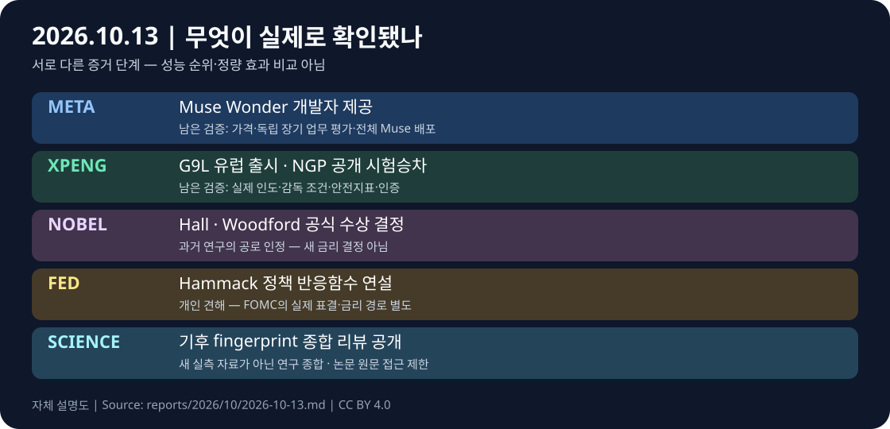

# 글로벌 테크 인텔리전스 리포트 — 2026-10-13

> **실제 실행 시작·컷오프:** 2026-10-13 08:43:15 KST / 2026-10-12 23:43:15 UTC  
> **직전 24시간:** 2026-10-12 08:43:15–2026-10-13 08:43:15 KST = 2026-10-11 23:43:15–2026-10-12 23:43:15 UTC.  
> [증거 원장](../../../sources/2026/10/2026-10-13.md) · [시각자료 명세](../../../assets/2026-10-13/README.md)

**연속성:** 직전 정식 리포트의 컷오프는 2026-10-11 23:54:49 UTC다. 이번 기본 24시간 구간과 **11분 34초 겹치며 미포함 공백은 없다**. 과거 미발행일 소급 발행 없음. 날짜만 확인된 발표는 UTC 시각이 검증되지 않았다고 명시한다.

*자체 제작한 증거 단계 설명 도표(CC BY 4.0). 실측 성능 그래프·현장 사진·투자 판단표가 아니다.*

## 핵심 요약

**실제 이용 가능성·시장 진입·정책 판단의 단계 구분**이 오늘의 공통 축이다. Meta는 새 모델을 개발자와 코딩 서비스에 제공했고, XPENG은 유럽 판매가격과 NGP 공개 시험승차를 제시했다. 경제학상 수상자 선정과 연준 인사의 발언은 **새로운 결정·발언**이지 새로운 금리 결정은 아니다. 기후 분야에서는 새로운 연구 종합 논문이 발표됐지만 개별 관측이 오늘 새로 발생한 것은 아니다.

| 순위 | 확인된 새로운 발전 | 분야 | 중요도 / 신뢰도 | 증거 단계 |
|---|---|---|---|---|
| 1 | Meta Muse Wonder·Wonder Full 발표 및 개발자 제공 | AI·테크 | High / High | 실제 모델 제공, 범위 차등 |
| 2 | XPENG G9L 유럽 출시·NGP VLA 2.0 공개 시험승차 | 로봇·자율주행 | High / Medium-High | 가격 공개·시험승차, 무인 상용운행 아님 |
| 3 | 2026 경제학상 Hall·Woodford 선정 | 경제·투자 | High / High | 공식 수상 결정 |
| 4 | Cleveland Fed Hammack의 인플레이션·정책 반응함수 연설 | 경제·투자 | Medium-High / High | 개인 정책 견해, FOMC 결정 아님 |
| 5 | 기후 인위적 영향 'fingerprint' 증거의 새 종합 리뷰 발표 | 과학·우주 | Medium-High / Medium | 동료심사 리뷰 공개, 원문 접근 제한 |

## 1. AI·테크 — Meta Muse Wonder·Wonder Full 실제 제공

### FACT
[Meta 공식 뉴스룸(2026-10-12)](https://about.fb.com/news/2026/10/introducing-muse-wonder-models/)은 Muse Wonder와 Muse Wonder Full을 발표했다. **Muse Wonder는 Meta Model API 및 Muse Code에서 제공**, **Muse Wonder Full은 Muse Code 구독자에게 제공**된다고 구분한다. Muse 개인 에이전트의 Wonder 적용은 **향후 구독자부터 확대할 계획**이며 지금 전체 이용자 배포가 완료됐다는 뜻이 아니다. [Reuters(10/12 18:26 UTC)](https://www.reuters.com/business/meta-releases-muse-wonder-ai-models-challenge-anthropic-openai-2026-10-12/)도 두 모델의 출시와 제한된 제공 경로를 보도했다.

### ANALYSIS
새로운 모델의 경쟁력은 성능표뿐 아니라 **개발자가 접근 가능한 API·서비스별 사용 권한·장기 작업 실행 신뢰성**에 달려 있다. 기존 Muse 서비스와 구별되는 이번 구간의 새 증거는 **Wonder 모델 계열의 출시 및 구체적인 접근 경로**다.

### UNCERTAINTY
Meta의 '최고 성능'은 회사 평가다. 외부 평가·실제 장기 업무 성공률·가격·처리량을 동일 조건에서 검증하지 않았다. 회사 페이지는 날짜만 표기해 정확한 게시시각 미확정; Reuters 시각으로 구간 내 공개 보도를 확인했다. Muse 전체 가입자에게 Wonder가 이미 적용됐다고 쓰지 않는다.

### WATCH
Meta Model API의 가격·rate limit·일반 접근성, Wonder Full의 API 확대 여부, 동일 작업 조건의 독립 agent benchmark, Muse 실제 배포 지역·구독 전환.

## 2. 로봇·자율주행 — XPENG 유럽 G9L 출시·VLA 2.0 NGP 공개 시험승차

### FACT
[XPENG 공식 배포자료(2026-10-12 08:35 EDT)](https://www.prnewswire.com/news-releases/xpeng-launches-the-g9l-next-gen-ai-flagship-suv-in-europe-debuts-ngp-and-expands-global-technology-collaboration-at-2026-paris-motor-show-302905653.html)는 파리 모터쇼에서 G9L을 **유럽 시장에 출시**하고 프랑스 **시작가격 €74,990**를 발표했다고 밝혔다. NGP(VLA 2.0 기반)는 유럽에서 **대규모 공개 시험승차**를 시작했다. 회사는 26개 국가·지역에서 누적 674만 km 이상 시험했다고 주장하지만 원시 안전데이터는 공개되지 않았다. [Reuters의 같은 날 파리 현장 취재](https://www.reuters.com/world/china/xpeng-executive-says-ev-maker-will-expand-european-production-ahead-local-2026-10-12/)는 XPENG의 유럽 현지생산 확대 방침을 별도로 확인했다.

### ANALYSIS
9월 중국 출시 및 유럽 생산시험 발표와 달리, 이번에 **유럽 현지 가격·판매 전개·일반 공개 시험승차**가 구체화됐다. 자동차 제조·AI 주행 기술의 해외 확장에서는 지역별 형식승인, 소비자 접근, 실제 주행 안전성의 검증이 핵심이다.

### UNCERTAINTY
€74,990는 프랑스의 **시작가**이지 모든 국가·트림 가격이 아니다. 591 km WLTP·충전 수치 등은 제조사 조건에 따른 사양으로, 시작가 차량의 동일 사양이라고 묶지 않았다. NGP 시험승차는 **완전 무인 상용운행·규제 인증 획득이 아니다**. 회사의 674만 km 수치는 독립 감사되지 않았고, IRON 휴머노이드 2027년 글로벌 배포는 **계획**이다.

### WATCH
프랑스 실제 주문·인도·현지 생산량, 유럽별 NGP 사용 허가와 감독 조건, 공개 안전지표·개입률, UNECE UN R171 인증 결과, IRON 유료 고객 인도 여부.

## 3. 경제·투자 — Hall·Woodford, 2026 노벨 경제학상 선정

### FACT
[스웨덴 왕립과학원 2026-10-12 공식 발표](https://www.kva.se/en/news/the-prize-in-economic-sciences-2026/)는 **Robert E. Hall**과 **Michael Woodford**를 '거시경제 안정화의 미시경제적 토대'에 기여한 공로로 선정했다. 공식 발표 행사는 **10/12 11:45 CEST = 09:45 UTC = 10/12 18:45 KST**로 공지됐으며, **상금 1,200만 스웨덴 크로나**를 공동 수상한다. [Reuters](https://www.reuters.com/world/hall-woodford-win-2026-nobel-economics-prize-2026-10-12/)가 수상자와 공로를 독립 보도했다.

### ANALYSIS
가계·기업의 미래 기대를 반영한 거시모형과 정책 소통의 중요성을 재조명한다. 오늘의 새로운 사실은 **수상자 선정**이지 오래전 발표된 경제이론이 10월 12일 새로 발견됐다는 뜻은 아니다. 아래 연준 발언의 '조건부 반응함수'와 개념적으로 연결된다.

### UNCERTAINTY
수상 결정이 특정 금리·물가·주가 경로를 보장하지 않는다. 과학원의 교육용 설명은 학문적 영향에 대한 평가이며, 이론이 모든 위기에서 동일한 예측력을 보인다는 실증 결론은 아니다.

### WATCH
10/13 수상 관련 공개 강연, 원 연구와 최근 정책 적용 사례, 기대인플레이션·실제 통화정책 결정 사이의 괴리.

## 4. 경제·투자 — Hammack, 긴축적 정책과 조기 소폭 조정 선호 발언

### FACT
[클리블랜드 연방준비은행 공식 연설(10/12 12:50 EDT = 16:50 UTC)](https://www.clevelandfed.org/collections/speeches/2026/sp-20261012-trimming-the-sails-communicating-my-reaction-function)에서 Beth Hammack 총재는 물가 압력이 에너지 외 분야로 확산됐다며 **물가상승률 2% 복귀를 위해 제약적 통화정책 기조가 적절하다**고 밝혔다. 가능하다면 큰 사후 조정보다 **작고 상대적으로 빠른 조정**을 선호한다고 설명했다. [연준 보도자료](https://www.clevelandfed.org/collections/press-releases/2026/pr-20261012-cleveland-fed-president-hammack-speech)와 [Reuters](https://www.reuters.com/markets/us/feds-hammack-backs-restrictive-policy-says-better-if-it-comes-relatively-quickly-2026-10-12/)가 같은 내용을 확인했다.

### ANALYSIS
정책 예고보다 **경제지표에 따라 정책을 어떻게 조정할지**를 설명하는 발언이다. 연설에서는 AI 인프라 확충 수요가 일부 전자·첨단 부품의 가격을 높인다는 관찰도 제시돼 기술 투자와 물가의 연결고리를 보여준다.

### UNCERTAINTY
연설은 **Hammack 개인 견해**이며 FOMC의 금리 인상 결정이나 다음 회의의 확정 경로가 아니다. 기업 접촉 사례는 전체 경제의 확정 인과관계가 아니다. 연준 내부 견해 차이와 향후 CPI·고용 자료에 따라 전망이 달라질 수 있다.

### WATCH
10/14 예정 미국 CPI, 10/27–28 FOMC, 근원 PCE·기대인플레이션·임금·AI 관련 설비투자 비용의 변화.

## 5. 과학 — 인위적 기후 영향 탐지 연구의 새 종합 리뷰 공개

### FACT
[미국지구물리학회 AGU 공식 발표(2026-10-12)](https://news.agu.org/press-release/scientists-reaffirm-incontrovertible-evidence-of-human-influence-on-climate/)는 Benjamin Santer 등 연구진의 [Earth's Future 리뷰 논문(doi:10.1029/2026EF009129)](https://agupubs.onlinelibrary.wiley.com/doi/10.1029/2026EF009129) 공개를 알렸다. 논문은 **30년 이상 축적된 기후 '지문(fingerprint)' 연구**를 종합하며 대기·해양 등 다양한 관측과 모델에서 인위적 온실가스 증가의 신호를 검토했다. 2009년 미국 EPA의 기후 위해성 판단 이후 증거 축적을 재평가하는 **새로운 리뷰 공개**다.

### ANALYSIS
장기 과학 축적을 규제·산업의 위험평가 근거로 연결하는 **증거 종합 작업**이다. 새로운 단일 위성 관측이나 기후변화의 첫 발견이 아니라 기존의 독립 연구들을 종합한 검토라는 점이 중요하다.

### UNCERTAINTY
원 논문 Wiley 본문은 이번 웹 열람에서 접근되지 않아 AGU 학회 원문 설명으로만 FACT를 제한했다. 학회·대학 공동 발표는 **독립적인 2개 실험 검증이 아니다**. 발표 날짜는 10/12로 확인되나 정확한 게시 시각·시간대가 없어 24시간 구간 내의 분 단위 시점은 **미확정**이다. 논문은 리뷰이므로 독립적인 신규 측정치를 제시한 것처럼 표현하지 않는다.

### WATCH
원 논문 전문·방법론·인용 연구의 재확인, EPA 관련 실제 규제 절차와 공식 결정, 새 관측자료를 활용한 별도 정량 연구.

## 분야 간 연결

- **AI 모델의 출시 ↔ 물리적 자동화의 배포:** Meta는 개발자 접근 경로를 실제 열었고 XPENG은 유럽 시장 가격과 감독 하 공개 시험승차를 제시했다. 둘 다 성능 주장과 운영 성과·안전성을 구분해야 한다.
- **기대 형성 ↔ 통화정책:** 경제학상 선정 이유의 기대 기반 모형과 Hammack의 조건부 정책 소통은 같은 문제의 서로 다른 층위다. 수상 결정이 금리정책을 바꾸었다는 뜻은 아니다.
- **장기 위험 ↔ 자본 배분:** AI 인프라·유럽 현지 생산 투자와 기후위험 과학은 각각 설비·에너지·규제 제약을 장기적으로 점검할 필요가 있다. 오늘의 리뷰가 특정 기업의 실적을 바꿨다는 근거는 없다.

## 후보 제외·반복 방지

[Johns Hopkins 의료 밀리로봇 소개](https://hub.jhu.edu/2026/10/12/magnetic-millirobots-cardiac-treatment/)는 10/12 공개됐지만 [원 논문은 9/28 최초 출판](https://advanced.onlinelibrary.wiley.com/doi/10.1002/admt.71353)으로 이번 구간의 새 실험 증거가 확인되지 않아 제외했다. [NTU 단백질 플랫폼 10/12 짧은 뉴스](https://www.ntu.edu.sg/news/detail/ai-platform-and-benchmark-database-predict-phase-separating-proteins) 역시 [원 기관 상세 발표 9/29](https://www.ntu.edu.sg/research/research-hub/news/detail/ai-powered-platforms-map-protein-phase-separation-across-species)의 반복으로 제외했다. [NASA 남극 해빙 10/12 소개](https://science.nasa.gov/earth/earth-observatory/antarctic-sea-ice-grows-to-its-2026-maximum/)의 1,759만 km²·역대 세 번째 낮은 최대치는 [NSIDC 9/23 발표](https://nsidc.org/news-analyses/news-stories/arctic-sea-ice-has-reached-minimum-extent-2026-antarctic-sea-ice-maximum-most-likely-reached-well)에서 이미 공개된 수치다. [ARPA-H SEEDS 지원](https://arpa-h.gov/explore-funding/awards/4758)의 시작일도 9/30로 확인돼 10/12 대학 보도자료만으로 신규 지급으로 세지 않았다. 분야별 추가 후보·예정 이벤트·한국 출처 점검은 [원장](../../../sources/2026/10/2026-10-13.md)에 남겼다.

## 누적 추세 반영

[AI 트렌드](../../../trends/artificial-intelligence.md)에 Muse Wonder의 **개발자 제공 경로**를, [자율주행 신호](../../../signals/autonomous-driving.md)에 XPENG의 **유럽 공개 시험승차·현지 가격**을 새 증거로 추가했다. 실제 무인 운행이나 고객 매출은 아직 확인되지 않았다. 경제학상·연준 개인 연설·기후 리뷰는 오늘의 사건으로 기록하되 다른 trends/signals의 방향을 기계적으로 바꾸지 않았다.

*이 보고서는 출처 기반 정보 추적 및 조건부 분석이며 투자·의료·정책 결정의 확정적 권고가 아니다.*
