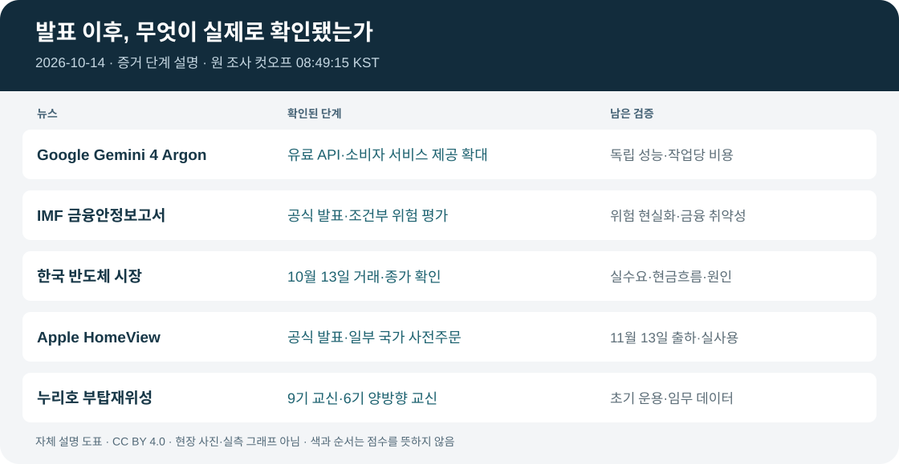

# 글로벌 테크 인텔리전스 리포트 — 2026-10-14

> **리포트 날짜·원 조사 컷오프:** 2026-10-14 / 2026-10-14 08:49:15 KST = 2026-10-13 23:49:15 UTC.
> **승인된 조사 구간:** 2026-10-13 08:43:15–2026-10-14 08:49:15 KST = 2026-10-12 23:43:15–2026-10-13 23:49:15 UTC (**24시간 6분**).
> [증거 원장](../../../sources/2026/10/2026-10-14.md) · [시각자료 명세](../../../assets/2026-10-14/README.md)

**연속성:** [전날 보고서](2026-10-13.md)의 컷오프부터 조사한다. 초안의 “6분 중복·공백 없음”을 정정해 기본 24시간 앞의 **공백 구간 6분**을 포함했다(사용자 재승인). 발행·검증 작업의 시각을 조사 컷오프로 바꾸지 않았다.

**추가 점검:** 최근 72시간(10/11 08:49:15–10/14 08:49:15 KST)은 기존 보고서와 누락 후보를 대조하는 별도 점검 범위다. 이 구간의 모든 사건을 오늘의 24시간 뉴스로 세지 않는다. 상세 결과·한계는 원장에 기록했다.

*자체 설명 도표(CC BY 4.0). 현장 사진·실측 성능 그래프·위험 점수가 아니다.*

## 핵심 요약

| 순위 | 새로운 발전 | 분야 | 중요도 / 신뢰도 | 확인 단계 |
|---|---|---|---|---|
| 1 | Google Gemini 4 Argon 유료 API·소비자 서비스 제공 확대 | AI·테크 | High / High | 기존 모델의 일반 제공 확대 |
| 2 | IMF, AI 투자·금융시장 위험 공식 경고 | 경제·투자 | High / High | 공식 보고서 발표에 대한 기관 설명 |
| 3 | 한국 반도체주 하락과 AI 투자심리 변화 | 경제·투자 | High / Medium-High | 10/13 거래·종가 |
| 4 | Apple HomeView 공개·일부 국가 사전주문 | AI·테크 | High / High | 발표·사전주문, 11/13 판매 예정 |
| 5 | 누리호 5차 부탑재위성 9기 교신 결과 확인 | 과학·우주 | Medium-High / Medium-High | 발사 후 공식 교신 결과 |

오늘의 핵심 흐름은 **AI 기술의 실제 이용 가능성이 확대되는 동시에, AI 인프라 투자에 대한 금융시장의 검증 요구가 강화되고 있다는 점**이다.

Google은 앞서 발표한 최상위 모델의 제공 범위를 개발자와 유료 이용자로 확대했다. Apple은 AI를 스마트홈의 중심 인터페이스로 확장하는 신제품을 발표했다.

반면 IMF는 AI 투자 기대가 충족되지 않을 경우 자산가격 조정이 발생할 수 있다고 경고했다. 한국 반도체 시장에서는 실제로 대규모 매도세가 나타났다.

우주 분야에서는 누리호 5차 발사의 후속 위성 교신 결과가 새롭게 공식 확인됐다. 이는 기존 발사 성공 발표를 반복하는 것이 아니라, 초기 운영 단계에서 추가로 확인된 결과다.

## 1. AI·테크 — Google Gemini 4 Argon 유료 API·소비자 서비스 제공 확대

**중요도: High | 신뢰도: High | 증거 단계: 실제 API 및 서비스 제공**

### FACT

Google은 [2026년 9월 30일 최초 발표](https://blog.google/innovation-and-ai/models-and-research/gemini-models/gemini-4-argon/)에서 Gemini 4 Argon을 제한된 보안 파트너에게 제공한다고 밝혔다. 이번 새 사실은 [10월 13일 발표](https://blog.google/intl/en-in/products/introducing-gemini-4-argon/)의 **유료 API·소비자 서비스 제공 확대**다. 발표 페이지의 게시 메타데이터는 **10월 13일 16:00 UTC = 10월 14일 01:00 KST**로 원 컷오프 이전이다.

[공식 개발자 안내](https://blog.google/innovation-and-ai/technology/developers-tools/build-with-gemini-4-argon/)에 따르면 유료 Gemini API를 통해 개발자가 이용할 수 있다. Gemini 앱·AI Mode는 Google AI Pro/Ultra, Antigravity는 Ultra 이용자 대상이며 서비스별 권한·한도가 다르다.

[Google 발표](https://blog.google/intl/en-in/products/introducing-gemini-4-argon/)의 API 초기 공개 요금은 입력 100만 토큰당 **2달러**, 출력 **10달러**다.

Google은 이 초기 요금이 2026년 11월 30일까지 적용되며 이후 각각 4달러와 20달러가 적용된다고 설명했다.

Google은 Argon이 코딩, 금융, 법률, 사이버보안, 과학 분야의 복잡한 다단계 작업에 특화됐다고 발표했다.

[Google 발표](https://blog.google/intl/en-in/products/introducing-gemini-4-argon/)의 회사 내부 사례에서는 Antigravity 기반 **에이전트 코드 제출량이 35% 초과 증가**, 코드 롤백이 **약 3분의 1 감소**했다고 주장했다.

이 수치는 Google이 제시한 내부 사용 결과이며, 모든 기업과 개발 환경에서 동일한 개선이 나타났다는 의미는 아니다.

출처: [G1 Google](https://blog.google/intl/en-in/products/introducing-gemini-4-argon/) · [G2 개발자 안내](https://blog.google/innovation-and-ai/technology/developers-tools/build-with-gemini-4-argon/) · [G3S Reuters (Investing.com 전재)](https://www.investing.com/news/stock-market-news/google-launches-flagship-ai-model-gemini-4-argon-for-developers-businesses-4947240). Reuters 원본의 직접 접근은 HTTP 401이며 전재 본문으로 교차검증했다.

### ANALYSIS

이번 발표의 핵심은 단순한 벤치마크 순위보다 **고성능 AI 모델이 실제 개발 환경과 업무 실행 도구에 연결됐다는 점**이다.

AI 경쟁의 중심은 질문에 답하는 성능에서 복잡한 작업을 계획하고 실행하며 결과를 검증하는 능력으로 이동하고 있다.

특히 소프트웨어 개발 분야에서는 코드 생성량 자체보다 실제 테스트 통과율, 수정 후 회귀 오류, 실행 비용과 작업 완료 시간이 중요해질 것이다.

기업은 모델의 지능뿐 아니라 API 가격, 장기 작업 안정성, 권한 관리와 기존 시스템 통합 비용을 비교해야 한다.

### UNCERTAINTY

- Google의 성능 우위 주장은 회사 발표 및 제시된 평가 결과에 기반한다.
- 내부 생산성 수치를 전체 개발자 집단으로 일반화할 수 없다.
- 초기 요금과 11월 30일 이후 요금이 다르므로 동일한 비용으로 장기 비교해서는 안 된다.
- 모든 사용자에게 동일한 기능과 이용 한도가 제공되는 것은 아니다.
- 공식 발표의 게시 메타데이터는 10/13 16:00 UTC다. 각 API·서비스의 실제 활성화 완료 시각을 직접 측정한 것은 아니다.

### WATCH

1. 11월 30일 이후 실제 API 가격 변경.
2. 독립적인 장기 코딩·에이전트 평가 결과.
3. 대규모 코드베이스에서의 테스트 통과율과 롤백률.
4. API 사용 한도 및 기업용 SLA.
5. 실제 고객의 비용 절감과 업무 완료 성과.

---

## 2. 경제·투자 — IMF, AI 투자 조정 위험 공식 경고

**중요도: High | 신뢰도: High | 증거 단계: 국제기구 정식 보고서 발표**

### FACT

국제통화기금(IMF)은 2026년 10월 13일 최신 Global Financial Stability Report를 발표했다.

[IMF 공식 발표](https://mediacenter.imf.org/news/imf---global-financial-stability-report-annual-meetings--2026/s/f55368c1-983b-45b7-ba7c-1978f67c168c)는 보고서가 글로벌 금융시장의 회복력을 평가하면서도 금융안정 위험은 여전히 높다고 설명했다. 아래 위험은 이 공식 설명에서 직접 확인한 내용이며 보고서 전문을 열람했다는 뜻은 아니다.

IMF는 주요 위험으로 다음 세 가지를 제시했다.

첫째, AI 관련 투자와 기업 수익에 대한 기대가 충족되지 않을 경우 AI 관련 자산가격이 조정될 가능성이다.

둘째, 인플레이션과 재정 불균형, 대규모 채권 발행에 따른 국채금리 상승 위험이다.

셋째, 금융 서비스의 디지털화와 상호 연결성이 확대되는 가운데 사이버 사고가 금융시장의 신뢰를 훼손할 위험이다.

IMF는 이러한 위험이 각각 발생할 때보다 기존 금융시스템의 취약성과 결합할 때 충격이 확대될 수 있다고 설명했다.

이는 AI 투자 붕괴가 확정됐다는 발표가 아니라, 금융안정 측면에서 주의해야 할 조건을 제시한 것이다.

출처: [I1 IMF 공식 발표](https://mediacenter.imf.org/news/imf---global-financial-stability-report-annual-meetings--2026/s/f55368c1-983b-45b7-ba7c-1978f67c168c) · [I3S Reuters (Investing.com 전재)](https://www.investing.com/news/economy-news/imf-cites-ai-slowdown-spiking-yields-as-looming-global-market-risks-4945345). [I2 보고서 안내](https://www.imf.org/en/publications/gfsr/issues/2026/10/13/global-financial-stability-report-october-2026)는 이번 열람에서 예정 페이지였으므로 전문 근거로 사용하지 않았다.

### ANALYSIS

AI 산업은 기술 경쟁과 함께 막대한 자본투자가 필요한 산업으로 발전했다.

데이터센터, 반도체, 전력망, 네트워크에 대한 투자는 실제 매출이 발생하기 전에 상당한 비용을 요구한다.

이 때문에 기업의 장기 성장 기대가 높더라도 자금조달 금리가 상승하거나 수익화 속도가 예상보다 느리면 기업가치와 투자 계획이 동시에 영향을 받을 수 있다.

IMF의 경고는 기존의 AI 인프라 확대 추세를 부정하는 것이 아니라, **투자 규모보다 투자수익률과 자금조달 지속가능성이 중요해지는 단계**를 보여준다.

### UNCERTAINTY

- IMF는 특정 AI 기업의 파산이나 시장 붕괴를 예측한 것이 아니다.
- AI 관련 기업의 위험은 부채 구조, 현금흐름, 고객계약에 따라 크게 다르다.
- 시장 조정 가능성과 실제 산업 수요 감소는 별개의 문제다.
- 보고서 전문은 직접 확보하지 못했다. 기관 발표와 전재 보도에서 확인한 위험 범위만 쓴다.
- 공식 보도자료에서 확인되지 않은 개별 금융기관의 취약자산 비율은 본문에 포함하지 않았다.

### WATCH

1. AI 관련 기업의 신용스프레드.
2. 데이터센터 투자기업의 현금흐름과 부채 만기.
3. 대형 기술기업의 CAPEX 대비 매출 성장.
4. 국채금리와 회사채 발행금리.
5. AI 인프라 프로젝트의 취소·연기·재조정 사례.

---

## 3. 경제·투자 — 한국 반도체주 급락과 AI 투자심리 변화

**중요도: High | 신뢰도: Medium-High | 증거 단계: 실제 시장 거래 결과**

### FACT

2026년 10월 13일 한국 증시에서 반도체 관련 주식을 중심으로 강한 매도세가 발생했다.

[Investing.com의 10월 13일 과거 데이터 행](https://kr.investing.com/indices/kospi-historical-data)에서 코스피 종가는 **6,035.35포인트(-5.46%)**다. 전 거래일 6,384.24와 차감하면 **348.89포인트** 하락이다.

각 종목의 같은 거래일 과거 데이터에서 [SK하이닉스](https://kr.investing.com/equities/sk-hynix-inc-historical-data)는 **10.09%**, [삼성전자](https://kr.investing.com/equities/samsung-electronics-co-ltd-historical-data)는 **7.39%** 하락했다.

[Reuters (MarketScreener 게재본)](https://www.marketscreener.com/news/brutal-session-for-chip-stocks-shows-ai-trade-is-turning-ce785ddddd8ff322)은 이날 한국 반도체주 매도세와 자본조달 비용, AI 투자 수익성에 대한 우려를 보도했다. 해당 기사가 중국 메모리 경쟁 우려를 보도했다는 초안 문구는 직접 확인되지 않아 삭제했다.

Reuters 기사에서 언급된 코스피 6% 이상 하락은 기사 작성 과정의 시장 수치이며, 위에서 제시한 최종 종가 기준 -5.46%와 구분해야 한다.

Reuters는 AI 관련 반도체 투자에 대한 시장의 관심이 투자 확대 자체에서 수익화와 자본효율성으로 이동하고 있다는 시장 관계자들의 평가도 전했다.

출처: [K1S Reuters (MarketScreener 게재본)](https://www.marketscreener.com/news/brutal-session-for-chip-stocks-shows-ai-trade-is-turning-ce785ddddd8ff322) · [K2 코스피](https://kr.investing.com/indices/kospi-historical-data) · [K2H SK하이닉스](https://kr.investing.com/equities/sk-hynix-inc-historical-data) · [K2S 삼성전자](https://kr.investing.com/equities/samsung-electronics-co-ltd-historical-data). 원본 Reuters는 HTTP 401이며, 거래소 원본 데이터는 직접 확보하지 못했다.

### ANALYSIS

한국 반도체 산업은 AI 인프라 투자 확대의 주요 수혜 산업 중 하나다.

그러나 글로벌 AI 투자에 대한 기대가 조정되면 실제 기업 실적의 변화가 발생하기 전에도 주가가 크게 움직일 수 있다.

이번 하락은 메모리 반도체의 실수요가 즉시 감소했다는 증거라기보다, 투자자들이 향후 수익성과 경쟁구조를 더 엄격하게 평가하기 시작했다는 시장 신호로 해석할 수 있다.

중국 메모리 경쟁을 평가할 때에는 기술 발표를 실제 양산 능력, 수율, 고객 인증과 구분해야 한다.

향후 중요한 것은 하루의 주가 하락보다 **실제 메모리 가격·출하량·고객 수요와 기업의 현금흐름이 시장 우려를 뒷받침하는지**다.

### UNCERTAINTY

- 코스피 종가의 거래소 원본 데이터를 직접 확보하지 못해 보조 시장데이터를 사용했다.
- Reuters의 기사 작성 시점 수치와 최종 종가 수치는 동일한 관측값이 아니다.
- 하루의 급락 원인을 특정 발언이나 기업 발표 하나로 단정할 수 없다.
- 중국 경쟁사의 기술 발전이 한국 기업의 실제 시장점유율 하락으로 이어졌는지는 아직 확인되지 않았다.
- 주가 변화만으로 장기 산업 전망을 확정하지 않는다.

### WATCH

1. 삼성전자·SK하이닉스의 실제 DRAM·HBM 출하량.
2. 메모리 가격과 재고 추이.
3. 중국 메모리 업체의 양산·수율·고객 인증.
4. TSMC 및 주요 반도체 장비업체의 실적.
5. AI 인프라 기업의 자금조달 비용과 설비투자 계획.

---

## 4. AI·테크 — Apple HomeView 공개와 스마트홈 AI 확대

**중요도: High | 신뢰도: High | 증거 단계: 제품 공식 발표 및 사전주문**

### FACT

[Apple은 2026년 10월 13일 HomeView를 발표했다](https://www.apple.com/gw/newsroom/2026/10/meet-apple-homeview-a-new-way-to-enjoy-entertainment-and-manage-the-home/).

HomeView는 7인치 Liquid Retina 디스플레이를 탑재하고, Siri AI를 이용해 가정 내 기기 제어, 정보 확인, FaceTime 및 개인화된 서비스를 제공하도록 설계됐다.

Apple은 얼굴 인식에 따른 이용자별 개인화 화면을 설명했다. **Siri AI는 HomeView 소프트웨어 27.2에서 베타**이며, 개인 맥락 요청에는 연결된 **Apple Intelligence 지원 iPhone·iPad**, 지원 언어와 Siri AI 설정이 필요하다([공식 각주 2](https://www.apple.com/gw/newsroom/2026/10/meet-apple-homeview-a-new-way-to-enjoy-entertainment-and-manage-the-home/)).

미국 기준 제품 가격은 299달러다.

미국 등 일부 국가에서는 10월 13일부터 사전주문을 시작했으며, 실제 제품 판매는 11월 13일부터 진행될 예정이다.

Apple은 유럽연합에서는 Siri AI 관련 서비스 제공 제약으로 HomeView를 판매하지 않는다고 밝혔다.

따라서 이번 발표를 전 세계 모든 국가에서 실제 판매가 시작된 사건으로 표현해서는 안 된다.

출처: [A1 Apple 공식 발표](https://www.apple.com/gw/newsroom/2026/10/meet-apple-homeview-a-new-way-to-enjoy-entertainment-and-manage-the-home/) · [A2S Reuters (MarketScreener 게재본)](https://www.marketscreener.com/news/apple-to-unveil-new-smart-home-products-showcasing-updated-siri-ai--ce785ddddc8efe2c). Reuters 원본 직접 접근은 HTTP 401이다.

### ANALYSIS

HomeView는 생성형 AI의 적용 범위가 스마트폰과 컴퓨터에서 가정 내 공용 기기로 확대되고 있다는 사례다.

특히 가정에서는 여러 사용자의 개인정보, 기기 제어 권한, 음성 명령의 정확성, 보안이 동시에 중요하다.

AI가 단순히 질문에 답하는 수준을 넘어 실제 가정 내 작업을 수행하려면 사용자의 의도를 정확하게 파악하고, 민감한 명령에 대해서는 적절한 확인 절차를 거쳐야 한다.

이번 발표는 스마트홈 AI 경쟁에서 모델 성능뿐 아니라 기기 생태계, 개인정보 보호, 지역별 서비스 제공 가능성이 핵심 경쟁요소임을 보여준다.

### UNCERTAINTY

- 10월 13일은 발표 및 사전주문 시점이며, 일반 고객 대상 실제 출하는 11월 13일 예정이다.
- 한국 출시 일정과 가격은 확인되지 않았다.
- 얼굴 인식과 개인화 기능의 실제 정확성은 독립적으로 검증하지 않았다.
- Siri AI의 모든 기능이 모든 국가와 언어에서 제공되는 것은 아니다.
- 장기 판매량과 스마트홈 시장점유율은 아직 확인할 수 없다.

### WATCH

1. 11월 13일 실제 출하 여부.
2. 한국 및 EU 판매 일정.
3. Siri AI의 한국어 지원과 기능 제한.
4. 스마트홈 기기 제조사와의 호환성.
5. 개인정보 보호 및 기기 제어의 안전성 평가.

---

## 5. 과학·우주 — 누리호 5차 부탑재위성 9기 교신 결과 공식 확인

**중요도: Medium-High | 신뢰도: Medium-High | 증거 단계: 발사 후 교신 결과 추가 확인**

### FACT

[우주항공청 공식 상세 자료](https://www.kasa.go.kr/prog/plcyBrf/brief/kor/sub01_01_04/view.do?plcyBrfNo=519)와 [정책브리핑 전재](https://m.korea.kr/briefing/pressReleaseView.do?newsId=156784938)는 2026년 10월 13일 누리호 5차 부탑재위성 교신 결과를 발표했다. 정책브리핑 게시 메타데이터는 **10/13 09:00 KST = 00:00 UTC**다.

지난 10월 7일 발사 당시 부탑재위성 10기 중 9기가 정상 분리됐으며, 1기는 분리되지 않았다.

10월 13일 발표에서는 정상 분리된 부탑재위성 9기 모두에서 지상국과의 교신 또는 데이터 수신이 확인됐다.

다만 **9기 모두가 양방향 교신을 완료했다는 뜻은 아니다.**

공식 상세 결과에서 **6기는 양방향 교신**, **3기는 비콘·다운링크 수신**이 확인됐다. 3기 중 **슬레지·지비샛에는 업링크 시도가 명시**돼 있으며, **잭-007은 다운링크 확인까지만 명시**돼 있다. 세 위성 모두의 업링크 시도를 단정하지 않는다.

앞서 주탑재위성인 초소형군집위성 2~6호 5기의 발사 당일 초기 교신은 [10/8 보완 리포트](2026-10-08-supplement.md)에 기록돼 있다.

따라서 이번에 새롭게 확인된 사실은 10월 7일의 발사 성공 자체가 아니라 **부탑재위성 전체의 교신 결과를 공식적으로 정리했다는 점**이다.

출처: [N1 우주항공청 상세 본문](https://www.kasa.go.kr/prog/plcyBrf/brief/kor/sub01_01_04/view.do?plcyBrfNo=519) · [N1P 정책브리핑](https://m.korea.kr/briefing/pressReleaseView.do?newsId=156784938) · [N2 연합뉴스](https://www.yna.co.kr/view/AKR20261013060500017) · [N3 전자신문](https://www.etnews.com/20261013000076). N1/N1P는 같은 공식 자료이며 독립 출처 두 개가 아니다.

### ANALYSIS

우주 발사 임무의 성공은 발사체의 비행 성공만으로 평가할 수 없다.

위성 분리, 초기 신호 수신, 양방향 교신, 시스템 점검, 탑재체 운용, 실제 데이터 생산은 서로 다른 단계다.

이번 발표는 발사 후 위성 상태를 확인하는 초기 운영 과정에서 추가 진전이 있었음을 보여준다.

특히 다수 위성을 동시에 발사하는 임무에서는 위성별 분리·교신 결과와 이후 정상 운영 여부가 발사 서비스의 신뢰성을 평가하는 중요한 자료가 된다.

### UNCERTAINTY

- 9기 교신 확인과 9기 양방향 교신 완료는 다르다.
- 부탑재위성 1기의 미분리 문제는 해결되지 않았다.
- 초기 교신 성공이 전체 위성의 정상 임무 수행을 보장하지 않는다.
- 이번 검증에서는 공식 상세 본문과 정책브리핑 전재를 직접 확보했다.
- 전자신문은 잭-007을 양방향 교신 성공으로 서술하지만 공식 자료는 다운링크 확인까지만 명시한다. 위성별 단계는 공식 자료를 기준으로 기록했다.
- 10/13은 결과 발표일이다. 개별 위성의 교신·신호 수신은 10/7~9의 결과이며 발표 당일 모두 새로 교신했다는 뜻은 아니다.

### WATCH

1. 양방향 교신이 완료되지 않은 위성들의 후속 상태.
2. 미분리 위성의 원인 조사 결과.
3. 각 위성의 초기 운용 및 탑재체 점검 완료.
4. 실제 관측·실험 데이터 확보.
5. 누리호 6차 발사 일정과 다중위성 투입 신뢰성.

---

## 분야 간 연결 분석

### AI 모델 경쟁과 자본시장의 검증

Google의 새로운 모델 출시와 IMF의 금융안정 경고는 서로 반대되는 사건이 아니다.

AI 모델의 실제 이용 가능성이 확대되는 동시에, 이를 뒷받침하는 인프라 투자에 대한 수익성 검증도 강화되고 있다.

기술 발전이 지속되더라도 모든 인프라 투자가 동일한 경제적 성과를 보장하지는 않는다.

앞으로는 모델 성능, 고객 사용량, 실제 생산성 향상, 매출 전환, 인프라 투자수익률을 연결해 분석할 필요가 있다.

### AI 서비스의 확장과 지역별 제약

Google은 API와 업무 도구를 통해 AI의 사용 범위를 확대하고 있다.

Apple은 AI를 가정 내 하드웨어에 결합하고 있다.

두 사례 모두 기술 자체의 성능 외에 실제 접근 권한, 서비스 지역, 가격, 개인정보 보호와 신뢰성이 상용화의 중요한 조건이라는 점을 보여준다.

### 한국 산업에 대한 시사점

한국 반도체 시장의 급락은 AI 인프라 수요에 대한 기대가 자본시장에 얼마나 크게 반영돼 있는지 보여준다.

동시에 누리호의 후속 위성 교신 결과는 국내 우주산업에서 발사 이후 실제 임무 수행 능력을 검증하는 단계가 중요해지고 있음을 보여준다.

두 산업은 서로 다르지만, 공통적으로 **대규모 투자나 초기 성공 발표 이후의 실제 운영 성과**가 장기 경쟁력을 결정한다.

## 후보 제외 및 반복 방지

최종 5건에 포함되지 않은 주요 후보도 검토했다.

**로봇·자율주행:** Promise Robotics와 D.R. Horton의 주택 1,250채 이상 생산을 지원하는 다년간 상업 계약은 신규 계약으로 확인됐다. 그러나 실제 생산 완료·인도·수익성 자료가 없어 차순위로 평가했다. Nature Will의 Natura-1 로봇 기초모델 발표도 확인했으나 500억 매개변수 및 학습 데이터 규모는 회사 주장으로, 독립적인 실제 로봇 작업 성능 검증이 부족하다.

**과학·우주:** NASA의 SpaceX CRS-35 발사 성공도 확인했다. 실제 발사와 화물 운송은 새로운 사건이지만 ISS 도킹 및 최종 태양전지판 설치는 아직 예정 단계다. 이번에는 국내 다중위성 임무의 새로운 교신 결과를 우선 선정했다.

**AI·테크:** 삼성전자의 KES 2026 전시 발표를 확인했다. 그러나 주요 내용이 기존 AI 제품의 전시·체험에 집중돼 있어 신규 모델 출시나 실제 서비스 접근성 확대보다 정보가치가 낮다고 판단했다.

**경제·투자:** Goldman Sachs의 2026년 3분기 실제 실적 발표를 확인했다. 매출 186억 8,000만 달러와 순이익 52억 9,000만 달러는 검증 가능한 신규 실적이다. 다만 이번에는 글로벌 AI 투자 위험과 한국 반도체 시장의 실제 조정을 우선 선정했다.

## 누적 추세 판단

- **AI:** 새로운 모델의 API 제공은 개발자 접근성 확대 추세를 강화한다.
- **AI 인프라:** IMF의 위험 평가와 한국 반도체 시장의 조정은 투자수익률·자본비용을 독립적으로 추적해야 한다는 판단을 강화한다.
- **우주:** 누리호 후속 교신 결과는 발사 이후 초기 운영 검증의 중요성을 강화한다.
- **로봇:** 신규 상업 계약 후보는 확인했으나 실제 운영성과가 부족해 장기 추세 판단은 유지한다.

[AI 동향](../../../trends/artificial-intelligence.md)에는 실제 제공 확대와 접근 조건을, [우주·과학 동향](../../../trends/space-science.md)에는 위성별 교신 단계의 후속 검증을, [AI 인프라 신호](../../../signals/ai-infrastructure.md)에는 투자수익률·자본비용을 선택적으로 반영한다. 다른 추세·신호의 방향을 기계적으로 바꾸지 않는다.

후보 원문: [R1 Promise Robotics](https://www.aol.com/articles/promise-robotics-expands-physical-ai-130500000.html) · [R2 Nature Will](https://www.tmcnet.com/usubmit/-physical-ai-lab-nature-will-unveils-natura-1-/2026/10/13/10461867.htm) · [S1 NASA](https://www.nasa.gov/news-release/nasa-science-cargo-launch-on-35th-spacex-resupply-mission-to-station/) · [T1 삼성전자](https://news.samsung.com/kr/%EC%82%BC%EC%84%B1%EC%A0%84%EC%9E%90-kes-2026-%EC%B0%B8%EA%B0%80-%EC%9D%BC%EC%83%81%EC%97%90-%EC%8A%A4%EB%A9%B0%EB%93%A0-ai-%EB%9D%BC%EC%9D%B4%ED%94%84-%EA%B3%B5%EA%B0%9C) · [E1 Goldman Sachs](https://www.goldmansachs.com/pressroom/press-releases/2026/2026-10-13-q3-results).

이번 발행은 사용자 승인 초안과 사실 검증 후 승인된 수정에 기반한다. 게시 후 실제 검증 결과는 증거 원장에 완료형으로 기록한다.
