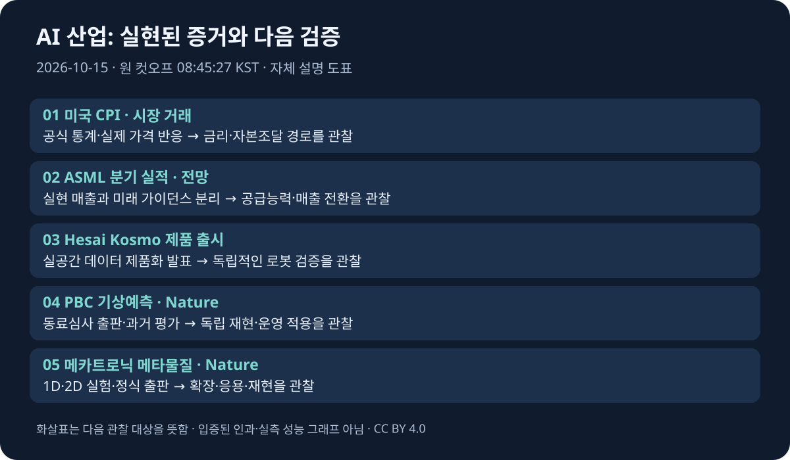

# 글로벌 테크 인텔리전스 리포트 — 2026-10-15

> **승인된 원 조사 컷오프:** 2026-10-15 08:45:27 KST / 2026-10-14 23:45:27 UTC.
> **조사 구간:** 2026-10-14 08:45:27–2026-10-15 08:45:27 KST / 2026-10-13 23:45:27–2026-10-14 23:45:27 UTC, 직전 24시간.
> [증거 원장](../../../sources/2026/10/2026-10-15.md) · [시각자료 명세](../../../assets/2026-10-15/README.md)

**연속성:** [직전 정식 리포트](2026-10-14.md)의 컷오프는 10/14 08:49:15 KST다. 오늘 시작점과 **3분 48초 겹치며 미포함 공백은 없다.** 발행 전 재검증 시각을 원 컷오프로 바꾸지 않았다.

사용자가 화면 초안의 당일 발행을 승인했다. 아래 5개 뉴스·핵심 수치·조사 범위를 공식 본문과 재대조했다. 검색 요약만으로 핵심 사실을 확정하지 않았다. 공식 문서에서 분 단위 게시시각을 확인하지 못한 경우 원장에 한계를 남긴다.

*자체 설명 도표(CC BY 4.0). 현장 사진·실측 성능 그래프가 아니며, 화살표는 입증된 인과관계를 뜻하지 않는다.*

## 핵심 요약

| 순위 | 새로운 발전 | 분야 | 중요도 / 신뢰도 | 증거 단계 |
|---|---|---|---|---|
| 1 | 미국 9월 CPI 전년 3.7%·전월 0.6%, AI 관련 주식 조정 | 경제·투자 | High / High | 정부 통계·실제 시장 거래 |
| 2 | ASML Q3 매출 116억 6,200만 유로와 전망 | AI·테크 | High / High | 실제 분기 실적·회사 가이던스 |
| 3 | Hesai Kosmo 3D 로봇 데이터 플랫폼 출시 | 로봇·자율주행 | High / Medium-High | 제품 출시·협력 발표 |
| 4 | PBC 기상예측 연구 Nature 정식 게재 | AI·과학 | Medium-High / High | 동료심사 출판·과거 평가 결과 |
| 5 | 메카트로닉 메타물질 진동 동기화 연구 Nature 게재 | 과학·로봇 | Medium-High / High | 실험 연구·동료심사 출판 |

AI 산업의 기술적 발전과 투자 수익성에 대한 시장 평가는 구분해야 한다. 물가와 AI 관련 주식 조정이 금융시장의 변수로 부상하는 동시에 ASML 실적은 장비 공급망의 매출 확대를 보여준다. 로봇 데이터 인프라와 과학 연구는 제품 공개·연구 결과와 실제 운영 성과를 구분해 읽는다. 분야별 건수를 억지로 맞추지 않았다.

## 01. 미국 소비자물가 상승과 AI 관련 주식 조정

**분야:** 경제·투자  
**중요도:** High  
**신뢰도:** High  
**증거 단계:** 정부 공식 통계 발표 + 실제 시장 거래

### FACT — 확인된 사실

미국 노동통계국(BLS)은 2026년 10월 14일 오전 8시 30분 미국 동부시간에 9월 소비자물가지수(CPI)를 발표했습니다.

주요 수치는 다음과 같습니다.

| 지표 | 2026년 9월 | 비교 |
|---|---:|---|
| CPI 전월 대비 | +0.6% | 8월 +0.4% |
| CPI 전년 대비 | +3.7% | 8월 +3.4% |
| 근원 CPI 전월 대비 | +0.3% | 8월 +0.3% |
| 근원 CPI 전년 대비 | +2.6% | 8월 +2.4% |
| 휘발유 가격 전월 대비 | +9.1% | 월간 전체 CPI 상승분의 절반 이상 기여 |

휘발유와 에너지 가격이 물가 상승의 주요 원인이었지만, 주거비 등 다른 항목에서도 상승 압력이 확인됐습니다.

[미국 노동통계국 9월 CPI 공식 발표](https://www.bls.gov/news.release/archives/cpi_10142026.htm)

이 발표 이후 미국 주식시장에서는 기술주와 AI 인프라 관련 기업을 중심으로 매도세가 나타났습니다.

AP는 10월 14일 나스닥지수가 1.9% 하락했으며 AI 관련 주식이 하락을 주도했다고 보도했습니다. 높은 국채금리가 데이터센터·AI 칩 투자의 자금조달 부담을 높일 수 있다는 설명도 제시했습니다.

[AP 미국 증시 마감 보도](https://apnews.com/article/stock-markets-earnings-bonds-artificial-intelligence-704d3190f0fba2908df07c85f26346ec)

### ANALYSIS — 의미와 파급효과

이번 물가 발표의 핵심은 단순히 CPI가 예상보다 높았다는 점이 아닙니다.

**AI 인프라 산업의 투자비용을 결정하는 금리 환경이 다시 악화될 수 있다는 점**이 중요합니다.

AI 데이터센터 산업은 서버, GPU, 메모리, 네트워크, 냉각, 전력설비 등에 대규모 자본투자를 요구합니다.

특히 차입금 의존도가 높은 기업은 다음과 같은 영향을 받을 수 있습니다.

금리가 상승하면 신규 프로젝트의 자금조달 비용이 증가하고, 기존 부채의 차환 부담도 커질 수 있습니다. 또한 미래 현금흐름에 대한 할인율이 높아져 기업가치 평가에 불리하게 작용할 수 있습니다.

그러나 모든 AI 기업이 동일한 영향을 받는 것은 아닙니다.

현금흐름이 충분한 대형 기술기업과 외부 차입에 크게 의존하는 인프라 기업은 구분해서 분석해야 합니다.

### UNCERTAINTY — 한계

물가 상승이 곧바로 미국 연방준비제도의 금리 인상을 확정하는 것은 아닙니다.

또한 하루의 주가 하락만으로 AI 산업의 실제 수요가 감소했다고 결론 내릴 수 없습니다.

주식시장 하락에는 물가, 금리, 기업 실적, 기존 주가 수준과 투자자들의 위험 회피 심리가 복합적으로 작용합니다.

### WATCH — 다음 관찰 지표

[10월 27~28일 예정된 FOMC 회의](https://www.federalreserve.gov/monetarypolicy/fomccalendars.htm)에서 실제 정책금리 결정과 향후 통화정책 설명을 확인해야 합니다.

함께 추적할 지표는 미국 국채금리, AI 인프라 기업의 회사채 금리, 데이터센터 신규 투자계획, 대형 기술기업의 설비투자와 실제 현금흐름입니다.

---

## 02. ASML, AI 반도체 장비 수요 확대와 3분기 실적 발표

**분야:** AI·테크 / 반도체  
**중요도:** High  
**신뢰도:** High  
**증거 단계:** 실제 분기 실적 + 향후 전망

### FACT — 확인된 사실

네덜란드 반도체 장비기업 ASML은 2026년 10월 14일 3분기 실적을 발표했습니다.

공식 발표에 따르면 주요 실적은 다음과 같습니다.

| 항목 | 2026년 3분기 | 2026년 2분기 |
|---|---:|---:|
| 매출액 | 116억 6,200만 유로 | 93억 2,600만 유로 |
| 순이익 | 49억 6,000만 유로 | 29억 1,800만 유로 |
| 매출총이익률 | 57.5% | 54.0% |
| 신규 노광장비 판매 | 113대 | 86대 |
| 설치 장비 관리 매출 | 약 32억 8,900만 유로 | 약 27억 6,200만 유로 |

ASML은 2026년 연간 매출 전망을 **440억~450억 유로**로 제시했습니다.

4분기 매출 전망은 142억~152억 유로입니다.

또한 ASML 경영진은 고객들이 2029년과 2030년 장비 주문에 관심을 보이고 있다고 밝혔습니다.

다만 이는 해당 연도의 주문이 모두 확정됐다는 의미가 아닙니다.

회사는 현재 계획된 생산능력으로는 2027년과 2028년 고객 수요를 모두 충족하기 어려울 것으로 예상하고 있습니다.

[ASML 2026년 3분기 공식 실적 발표](https://www.investor.asml.com/news-releases/news-release-details/asml-reports-eu11.7-billion-total-net-sales-and-eu5.0-billion-net-income-q3-2026)

[Reuters (Euronext 전재)](https://live.euronext.com/en/financial-news/asmls-strong-orders-ease-fears-ai-spending-boom-running-out-steam)도 장기 장비 수요와 생산능력 확대 검토를 교차 확인했습니다.

### ANALYSIS — 의미와 파급효과

이번 실적은 전날 IMF의 AI 투자 위험 경고와 비교할 때 특히 중요합니다.

금융시장은 AI 투자 수익성에 대한 우려를 나타내고 있지만, 반도체 제조장비 공급망에서는 **실제 매출 증가와 높은 설비 수요가 동시에 확인되고 있기 때문**입니다.

AI 인프라 시장을 하나의 산업으로만 보면 이러한 차이를 놓칠 수 있습니다.

반도체 제조장비 기업은 고객사의 신규 생산설비 투자에서 수익을 얻습니다. 반면 AI 데이터센터 운영기업은 완성된 설비에서 발생하는 서비스 매출과 운영비용에 따라 수익성이 결정됩니다.

따라서 AI 산업 전체의 장기 전망을 판단할 때는 장비 주문, 반도체 생산량, 데이터센터 가동률, AI 서비스 매출을 각각 추적해야 합니다.

한국 기업에도 중요한 의미가 있습니다.

삼성전자와 SK하이닉스 등 반도체 제조기업의 향후 설비투자 계획을 ASML의 수요 전망과 함께 비교할 필요가 있습니다.

### UNCERTAINTY — 한계

ASML의 실적은 실제 발생한 매출이지만, 2027~2030년 수요 전망은 경영진의 예상입니다.

장비 주문에 대한 관심과 확정 계약, 실제 장비 인도, 최종 고객의 AI 서비스 매출은 서로 다른 단계입니다.

또한 ASML의 강한 실적이 모든 반도체 기업의 이익 증가를 보장하지는 않습니다.

### WATCH — 다음 관찰 지표

TSMC와 주요 메모리 기업의 실제 설비투자 규모, ASML의 분기별 신규 주문, EUV 장비 생산능력 확대, 고객사의 장비 인도 지연 여부를 확인해야 합니다.

특히 **2027~2028년 장비 공급 부족 전망이 실제 주문잔고와 생산량으로 확인되는지**가 핵심입니다.

---

## 03. Hesai, 로봇 학습을 위한 3D 공간 데이터 플랫폼 Kosmo 출시

**분야:** 로봇·자율주행 / Physical AI  
**중요도:** High  
**신뢰도:** Medium-High  
**증거 단계:** 공식 제품 출시 및 협력 발표

### FACT — 확인된 사실

중국의 라이다 및 로봇 센싱 기업 Hesai는 2026년 10월 14일 새로운 3D 공간 데이터 플랫폼 **Kosmo**를 공개했습니다.

Kosmo는 크게 두 부분으로 구성됩니다.

**Kosmo One**은 실제 공간을 촬영하고 3차원 데이터를 수집하는 카메라 장치입니다.

**Kosmo World**는 수집된 데이터를 로봇 학습과 시뮬레이션에 사용할 수 있는 3차원 환경으로 변환하는 플랫폼입니다.

Kosmo One은 고해상도 라이다, 1인치 이미지 센서, 관성측정장치(IMU)를 통합합니다.

회사는 최대 8K 촬영을 지원한다고 설명하지만, 사용자에게 내보내는 파일의 최대 해상도는 6K라고 별도로 명시했습니다.

또한 3D Gaussian Splatting을 이용해 실제 환경을 재구성하며, NVIDIA Isaac Sim·Isaac Lab 등과 연동할 수 있다고 설명했습니다.

Hesai는 Galbot 및 Dexmal과 새로운 전략적 협력도 발표했습니다.

[Hesai Kosmo 공식 출시 발표](https://www.hesaitech.com/9974-2/)

[SCMP의 현장 보도](https://www.scmp.com/business/china-evs/article/3370897/hesai-launches-3d-spatial-camera-chinese-lidar-maker-expands-physical-ai?pgtype=live)에서도 10월 14일 제품 공개와 미디어 브리핑을 확인했습니다. 공식 전재문은 [Hesai 제공 PRNewswire](https://www.prnewswire.com/news-releases/building-the-data-infrastructure-for-physical-ai-hesai-launches-kosmo-3d-world-data-engine-302908956.html)에서 10월 14일 14:04 ET로 표시됩니다. 이는 독립 보도가 아닙니다.

### ANALYSIS — 의미와 파급효과

이번 발표에서 가장 중요한 부분은 로봇의 새로운 동작을 보여주는 시연이 아닙니다.

**실제 세계를 로봇 학습에 활용할 수 있는 데이터로 변환하는 과정을 제품화하려는 시도**라는 점입니다.

로봇 학습에는 대량의 환경 데이터가 필요합니다.

그러나 실제 작업공간을 시뮬레이션에 활용하려면 물체의 위치, 표면 형상, 깊이, 카메라 좌표계, 충돌 형상 등을 구성해야 합니다.

이 작업은 상당한 시간과 인력이 필요한 과정입니다.

Kosmo가 이러한 과정을 안정적으로 자동화한다면 로봇 학습용 환경을 만드는 비용을 줄일 가능성이 있습니다.

특히 로봇 연구개발에서는 다음과 같은 연결이 중요합니다.

**실제 환경 스캔 → 3D 재구성 → 시뮬레이션 환경 생성 → 로봇 정책 학습 → 실제 로봇 검증**

이 과정이 표준화되면 로봇 학습 데이터의 확보와 재사용이 쉬워질 수 있습니다.

### UNCERTAINTY — 한계

Hesai는 약 100㎡ 실내 공간을 15분 정도에 스캔할 수 있다고 주장합니다.

또한 특정 아이스크림 매장 로봇 사례에서 높은 작업 성공률을 제시했습니다.

그러나 이러한 수치는 회사가 공개한 조건과 사례에 기반하며, 여러 환경에서 독립적으로 재현된 일반적인 성능으로 볼 수 없습니다.

3D 재구성 정확도가 높더라도 로봇의 실제 조작 성공률이 자동으로 향상되는 것은 아닙니다.

특히 마찰, 접촉력, 변형 가능한 물체, 가려진 물체의 상태 등은 별도의 모델링과 검증이 필요합니다.

### WATCH — 다음 관찰 지표

Kosmo의 실제 판매가격과 사용료, 데이터셋 내보내기 형식, ROS2·MuJoCo 등과의 호환성, 재구성 정확도, 동적 환경 지원 여부를 확인해야 합니다.

가장 중요한 것은 **Kosmo로 생성한 환경에서 학습한 정책이 실제 로봇에서 얼마나 안정적으로 작동하는지**입니다.

---

## 04. Microsoft 연구진, AI 기상예측 오차 보정 연구 Nature 게재

**분야:** AI·테크 / 과학  
**중요도:** Medium-High  
**신뢰도:** High  
**증거 단계:** 동료심사 논문 정식 게재 및 기존 평가 결과 공개

### FACT — 확인된 사실

Microsoft 연구진과 공동연구자들이 개발한 **Probabilistic Bias Correction(PBC)** 연구가 2026년 10월 14일 학술지 Nature에 정식 게재됐습니다.

논문 제목은 *Advancing subseasonal forecasting with machine learning*입니다.

이 연구는 2~6주 후의 기상예측에서 발생하는 체계적인 오차를 머신러닝으로 보정하는 방법을 제시합니다.

기존 물리 기반 기상모델과 AI 기상모델을 완전히 대체하는 것이 아니라, 기존 모델이 생성한 확률예측을 개선하는 방식입니다.

연구진은 유럽중기예보센터(ECMWF)의 기존 예측시스템에 PBC를 적용했습니다.

논문에 따르면 기존 운영용 편향 보정 방식과 비교했을 때 기압 목표의 91%, 기온 목표의 92%, 강수량 목표의 98%에서 예측 성능 개선이 나타났습니다.

여기서 **98%는 강수량 예측의 정확도가 98%라는 뜻이 아닙니다.** 비교 대상 예측 목표 중 개선이 나타난 비율입니다.

연구진은 2025년 ECMWF 실시간 예측 경진대회에서도 높은 성과를 기록했다고 보고했습니다.

[Nature 원 논문](https://www.nature.com/articles/s41586-026-11126-x)

[Microsoft Research 연구 설명](https://www.microsoft.com/en-us/research/story/new-ai-framework-bridges-a-critical-gap-in-mid-range-weather-forecasts/)

### ANALYSIS — 의미와 파급효과

AI 기상예측 경쟁은 새로운 거대 모델을 만드는 방향으로만 진행되지 않습니다.

기존 모델의 체계적인 오류를 수정하는 방법도 중요한 연구 방향입니다.

PBC는 이러한 접근의 대표적인 사례입니다.

특히 2~6주 예측은 농업, 에너지, 수자원 관리와 재난 대비에서 중요한 시간 범위입니다.

기상예측의 정확도가 개선되면 기업과 공공기관은 미래 위험을 더 일찍 파악하고 대응할 가능성이 있습니다.

또한 기존 기상예측 모델을 활용할 수 있다는 점에서 새로운 대규모 모델을 처음부터 학습하는 방식과 다른 장점이 있습니다.

### UNCERTAINTY — 한계

**이번 구간의 새로운 사건은 Nature 정식 게재입니다.**

연구 내용 자체는 [2026년 4월 Microsoft Research 자료](https://www.microsoft.com/en-us/research/publication/enhancing-ai-and-dynamical-subseasonal-forecasts-with-probabilistic-bias-correction/?lang=ko-kr)에서도 소개됐으므로, 모든 실험 결과가 10월 14일 처음 발견됐다고 표현해서는 안 됩니다.

논문에 포함된 2025년 경진대회 결과 역시 과거 평가 결과입니다.

또한 특정 평가자료에서 성능이 개선됐다는 사실이 모든 지역과 기상조건에서 같은 수준의 개선을 보장하지는 않습니다.

### WATCH — 다음 관찰 지표

독립적인 기상예측기관의 재현 결과, 다른 기상모델에 적용했을 때의 성능, 극한기상 예측 개선, 실제 운영 비용을 확인해야 합니다.

특히 **연구 성과가 공공 기상예측 시스템의 실제 운영으로 연결되는지**가 중요합니다.

---

## 05. 로봇형 메타물질에서 자발적인 진동 동기화 현상 입증

**분야:** 과학·로봇  
**중요도:** Medium-High  
**신뢰도:** High  
**증거 단계:** 새로운 실험 연구의 동료심사 논문 발표

### FACT — 확인된 사실

영국 버밍엄대학교와 네덜란드 암스테르담대학교 등의 공동연구진은 2026년 10월 14일 Nature에 새로운 메카트로닉 메타물질 연구 결과를 발표했습니다.

논문 제목은 *Wave coarsening drives time crystallization in mechatronic metamaterials*입니다.

연구진은 센서, 액추에이터, 탄성 구조물, 제어회로를 결합한 실험 장치를 제작했습니다.

이 장치에서는 개별 구성요소의 진동이 상호작용하면서 점차 더 큰 규모의 동기화된 진동 패턴으로 발전하는 현상이 관찰됐습니다.

연구진은 이를 **Wave Coarsening**이라는 개념으로 설명했습니다.

실험에서는 1차원 및 2차원 메타물질에서 이러한 현상을 관찰했고, 이론 및 시뮬레이션과 비교했습니다.

[Nature 원 논문](https://www.nature.com/articles/s41586-026-11163-6)

[버밍엄대학교 공식 연구 발표](https://www.birmingham.ac.uk/news/2026/chaos-to-coordination-vibrating-material-organises-itself-into-a-single-rhythm)

### ANALYSIS — 의미와 파급효과

일반적인 로봇 시스템은 중앙 제어기가 각 액추에이터의 동작을 계산하고 명령하는 구조를 많이 사용합니다.

이번 연구는 구성요소 사이의 국소적인 상호작용만으로도 전체 시스템에서 질서 있는 동작 패턴이 형성될 수 있음을 보여줍니다.

이는 장기적으로 소프트 로봇, 능동형 메타물질, 분산형 구동 시스템을 연구하는 데 활용될 가능성이 있습니다.

특히 복잡한 기계 구조에서 모든 동작을 중앙에서 직접 제어하지 않고, 물리적 상호작용을 활용해 움직임을 조직하는 방식은 흥미로운 연구 방향입니다.

### UNCERTAINTY — 한계

이번 연구는 메카트로닉 메타물질에서 관찰된 실험 결과입니다.

일반적인 산업용 로봇이나 휴머노이드에서 같은 방식이 실용적으로 구현됐다는 의미는 아닙니다.

또한 자발적인 진동 동기화와 특정 목표를 수행하는 로봇의 정밀 제어는 서로 다른 문제입니다.

연구 결과를 실제 로봇 제어 기술의 상용화로 표현해서는 안 됩니다.

### WATCH — 다음 관찰 지표

3차원 구조에서의 실험 재현, 더 큰 시스템으로의 확장, 에너지 효율, 외란에 대한 안정성, 실제 소프트 로봇의 움직임 제어 적용 여부를 추적해야 합니다.

---

## 분야 간 연결 분석

## AI 투자 수요와 금융시장 위험의 공존

오늘 가장 중요한 연결은 **ASML의 실제 실적과 미국 CPI 발표 이후의 시장 조정**입니다.

ASML은 반도체 장비 수요 증가를 실적과 전망으로 제시했습니다.

반면 금융시장에서는 높은 물가와 자금조달 비용에 대한 우려로 AI 관련 주식이 하락했습니다.

이 두 사건은 반드시 모순되는 것이 아닙니다.

산업의 실제 수요가 증가하더라도 주가가 이미 높은 성장 기대를 반영하고 있다면 금융시장에서 조정이 발생할 수 있습니다.

따라서 앞으로 AI 산업을 평가할 때는 **실제 매출 증가와 투자자 기대의 변화**를 구분해야 합니다.

## Physical AI의 핵심은 데이터와 검증

Hesai의 Kosmo 출시와 메카트로닉 메타물질 연구는 서로 다른 기술적 접근을 보여줍니다.

Kosmo는 로봇이 학습할 수 있는 환경 데이터를 만드는 기술입니다.

메타물질 연구는 기계적 구성요소들이 상호작용하며 움직임을 형성하는 물리적 원리를 연구합니다.

두 사례 모두 로봇의 지능을 단순히 AI 모델 성능만으로 평가할 수 없다는 점을 보여줍니다.

실제 로봇의 성능은 센서, 환경 데이터, 물리 모델, 제어, 하드웨어 신뢰성이 결합돼 결정됩니다.

## AI 연구의 산업 적용 가능성

Microsoft의 PBC 연구는 기존 시스템을 완전히 교체하지 않고 성능을 개선하는 AI 활용 사례입니다.

이러한 접근은 대규모 모델을 새로 만드는 방식과 달리 기존 산업 시스템에 AI를 결합하는 실용적인 방향을 보여줍니다.

다만 연구 결과가 실제 산업의 운영성과로 이어지는지는 별도로 검증해야 합니다.

---

## 후보 제외·반복 방지와 한국 자료 점검

승인된 최종 5개 선정은 유지했다. 전날의 Gemini 4 Argon·IMF·한국 반도체주·HomeView·누리호 교신은 이번 구간의 별도 핵심 새 증거 없이 다시 Top 5로 세지 않았다.

| 분야 | 검토 후보·경로 | 제외·보류 판단 |
|---|---|---|
| AI·테크 | Google 유럽 연구자 지원, Anthropic 선거정보 계획 | 초안 후보. 핵심 5개를 바꾸지 않으며, 미확인 집행·효과를 FACT로 추가하지 않음 |
| 로봇·자율주행 | Manchester 로보택시 시험 | 초안 후보. 원 발표 본문과 운영 단계의 추가 확인 없이 승객 서비스 개시로 쓰지 않음 |
| 과학·우주 | NASA Chandra Treble Clef 소개·원 preprint | 기관 소개는 10/14, preprint는 7/7·수정 10/5. 새로운 관측이 당일 처음 이뤄졌다고 쓰지 않음. 게재·소개 단계의 후보로 비교 후 산업적 활용 범위를 고려해 제외 |
| 경제·투자 | 미국 은행 분기 실적 | AP 보도에서 확인한 후보. 이번에는 물가·AI 자본조달의 파급 범위를 우선 |

발행 전 한국어 재점검에서는 삼성전자 공식 목록의 **10/14 갤럭시 AI·빅스비 언어 확대와 삼성 헬스 업데이트**, 과기정통부의 양자 협력·로보틱스 논의 등을 후보로 확인했다. 초안의 “한국 새 핵심 발표 미확인”은 기관에 발표가 없다는 의미로 사용하지 않는다. 이 목록 확인만으로 세부 기능·출시 범위나 산업 성과를 확정하지 않았으며, 최종 5개를 대체할 근거로 채택하지 않았다.

KASA 보도자료 경로는 접근 오류, KARI 보도 목록은 열람했으나 원 실험 자료 미확보, DART는 접근 오류, KIND는 동적 목록의 특정일 완전성 미확인이다. 한국 기관·공시를 빠짐없이 검토했다고 주장하지 않는다. 경로와 결과는 원장에 기록했다.

## 예정 이벤트 점검

| 항목 | 원 컷오프 기준 판단 |
|---|---|
| 10/14 미국 CPI | 실제 발표 완료: BLS 본문·발표시각 확인 |
| 10/14 ASML Q3 | 실제 실적 발표 완료 |
| 10/14 두 Nature 논문 | 정식 게재일 확인, 최초 게시시각·시간대 미확정 |
| NASA CRS-35 도킹 | 초안의 컷오프 이후 관찰 항목으로 유지. 완료 사실을 추가하지 않음 |
| 10/15 모기지·10/16 Surface | 초안의 후속 관찰 항목. 이번 리포트의 완료 성과로 세지 않음 |
| 10/27–28 FOMC | 연준 공식 일정 확인 |
| 삼성전자 상세 실적 | 초안의 10/29 일정은 재검증 미완료. 공식 확정 일정으로 추가 단정하지 않고 후속 확인 대상으로 유지 |

## 누적 추세 반영

- [AI 동향](../../../trends/artificial-intelligence.md): 기존 예측모델의 확률 오차 보정과 정식 출판 증거를 추가한다.
- [AI 인프라 신호](../../../signals/ai-infrastructure.md): 장비 공급자 실현 매출·회사 전망과 자본비용 위험을 구분해 추가한다.
- [Physical AI 신호](../../../signals/physical-ai.md): 공간 데이터 제품 공개를 추가하되 독립적인 로봇 학습 성능 입증으로 올리지 않는다.
- 다른 누적 문서는 이 발행만을 이유로 기계적으로 갱신하지 않는다.

오늘의 우선 관찰 대상은 미국 금리 경로, ASML의 장비 수요·생산능력, Kosmo 환경을 이용한 실제 로봇 검증이다. 연구실에서 검증된 성과와 산업 운영 성과를 구분한다.
