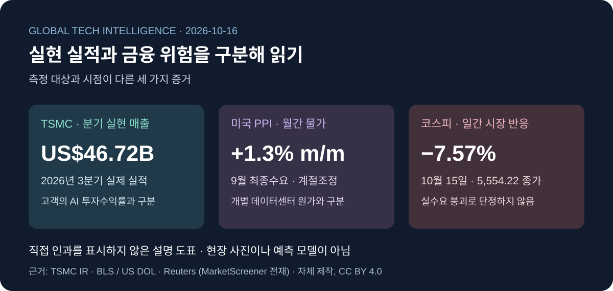

# 글로벌 테크 인텔리전스 리포트 — 2026-10-16

> **승인된 원 조사 컷오프:** 2026-10-16 09:03:07 KST / 2026-10-16 00:03:07 UTC.
> **기본 24시간:** 2026-10-15 09:03:07–2026-10-16 09:03:07 KST / 2026-10-15 00:03:07–2026-10-16 00:03:07 UTC.
> **별도 공백 점검:** 2026-10-15 08:45:27–09:03:07 KST / 2026-10-14 23:45:27–2026-10-15 00:03:07 UTC, **17분 40초**.
> [증거 원장](../../../sources/2026/10/2026-10-16.md) · [시각자료 명세](../../../assets/2026-10-16/README.md)

[직전 정식 리포트](2026-10-15.md)의 컷오프부터 연속성을 점검했다. 우주항공청 10/15 09:00 발표는 기본 24시간 밖이며 공백 구간의 새 공식 공개로 구분한다. 실제 위성 촬영은 발사 이후의 과거 사건이다. 과거 날짜 리포트를 새로 발행하지 않는다. 발행 전 재검증 시각을 원 컷오프와 혼동하지 않는다.

사용자가 승인한 다섯 기사·핵심 수치·원 조사 구간을 유지했다. 기업 실적과 전망, 시장 보도와 거래소 확정 데이터, 기관 자체 평가와 독립 검증을 구별한다.

*저장소 자체 제작 설명 도표, CC BY 4.0. 세 지표 사이의 직접 인과관계나 동일한 측정 단위를 나타내지 않는다.*

## 핵심 요약

| 순위 | 핵심 발전 | 분야 | 중요도 | 확인 단계 |
|---|---|---|---|---|
| 1 | **TSMC, 3분기 역대 최고 수준의 실적 발표** | AI·반도체 | High | 실제 재무실적 |
| 2 | **한국 코스피 7.57% 급락, 장중 서킷브레이커 발동** | 경제·투자 | High | 실제 거래 결과 |
| 3 | **미국 생산자물가 전월 대비 1.3% 급등** | 경제·투자 | High | 정부 공식 통계 |
| 4 | **누리호 탑재 초소형군집위성 5기, 첫 관측 영상 획득 발표** | 과학·우주 | Medium-High | 공식 결과 발표 · 공백 구간 |
| 5 | **NASA, Artemis II 우주선 열차폐 성능의 추가 검증 결과 발표** | 과학·우주 | Medium-High | 실제 비행 후 공학 분석 |

분야별 개수를 맞추기 위해 뉴스의 중요도를 인위적으로 조정하지 않았습니다.

로봇·자율주행 분야도 조사했지만, 당일 새롭게 확인된 실제 성과의 규모와 검증 수준을 비교해 최종 5건에서는 제외했습니다. 대신 해당 분야의 후보와 제외 이유를 뒤에서 별도로 설명하겠습니다.

---

### 01. TSMC, 3분기 순이익 68.7% 증가 — AI 반도체 수요의 실제 실적 확인

**분야:** AI·테크 / 반도체  
**중요도:** High  
**신뢰도:** High  
**증거 단계:** 확정 분기 실적 및 기업 가이던스

#### FACT — 확인된 사실

세계 최대 파운드리 기업 TSMC는 **2026년 10월 15일**, 3분기 실적을 발표했습니다.

공식 발표에서 확인된 주요 지표는 다음과 같습니다.

| 지표 | 2026년 3분기 | 전년 동기 대비 |
|---|---:|---:|
| 매출액 | NT$1조 4,942억 4,000만 | +50.9% |
| 미국 달러 환산 매출 | 467억 2,000만 달러 | +41.2% |
| 순이익 | NT$7,630억 6,000만 | +68.7% |
| 주당순이익(EPS) | NT$29.43 | +68.7% |
| 매출총이익률 | 66.4% | 전년 동기 59.5% |

매출 증가율이 대만달러 기준과 미국 달러 기준에서 다른 것은 환산 통화와 환율의 차이 때문입니다. 두 수치를 같은 기준으로 혼용해서는 안 됩니다.

특히 3분기 웨이퍼 매출 중 **7나노미터 이하 첨단공정이 차지하는 비중은 79%**였습니다.

세부 비중은 2나노미터 8%, 3나노미터 33%, 5나노미터 28%, 7나노미터 10%입니다.

TSMC는 4분기 매출을 **523억~543억 달러**로 전망했습니다. 다만 이는 아직 실현되지 않은 회사의 가이던스입니다.

출처: [TSMC 공식 실적 발표](https://investor.tsmc.com/english/encrypt/files/encrypt_file/reports/2026-10/526b65af7305df2dde6b9ece6812b1fdf1e49f9b/3Q26%20EarningsRelease.pdf) · [TSMC 투자자 자료](https://investor.tsmc.com/english/quarterly-results/2026/q3) · [TSMC 분기 경영보고서](https://investor.tsmc.com/english/encrypt/files/encrypt_file/reports/2026-10/f83780000ddc0c3b48e57a87eab6814c4ab35058/3Q26%20ManagementReport.pdf).

#### ANALYSIS — 산업적 의미

이번 발표는 현재 AI 산업에서 가장 중요한 질문 중 하나에 답하는 자료입니다.

**AI 인프라에 실제 수요가 존재하는가?**

TSMC의 분기 실적은 첨단 반도체 제조 부문에서 실제 매출과 이익이 크게 증가했음을 보여줍니다.

이는 전날 발표된 ASML의 반도체 장비 실적과 함께 볼 필요가 있습니다.

ASML은 반도체 생산설비에 필요한 장비를 공급하고, TSMC는 고객이 설계한 반도체를 제조합니다.

서로 다른 공급망 단계에서 실제 실적 증가가 확인됐다는 점은 의미가 있습니다.

하지만 이를 곧바로 **AI 데이터센터 운영기업의 투자수익률이 충분하다는 증거**로 해석해서는 안 됩니다.

앞으로는 다음 단계를 구분해야 합니다.

반도체 제조장비 매출 증가 → 반도체 제조기업 매출 증가 → AI 인프라 운영 확대 → 최종 고객의 서비스 이용 증가 → 지속 가능한 이익 창출

현재 확인된 것은 이 가운데 일부 단계입니다.

#### UNCERTAINTY — 검증 한계

TSMC의 분기 실적은 확인된 수치지만, 향후 수요와 설비투자 전망은 회사의 예상입니다.

또한 첨단공정 매출 전체를 AI 반도체 매출로 간주할 수 없습니다. 스마트폰과 다른 고성능 반도체도 해당 공정을 사용하기 때문입니다.

4분기 매출 전망이 제시됐다고 해서 실제 매출이 이미 발생한 것은 아닙니다.

#### WATCH — 후속 관찰

TSMC의 4분기 실제 매출, 첨단공정별 출하량, 신규 생산시설 가동률, 설비투자 현금흐름을 추적해야 합니다.

한국 기업과 관련해서는 삼성전자·SK하이닉스의 HBM 출하량과 실제 고객 수요를 함께 비교할 필요가 있습니다.

---

### 02. 한국 코스피 7.57% 급락 — 반도체주 중심의 대규모 조정

**분야:** 경제·투자  
**중요도:** High  
**신뢰도:** Medium-High — 시장 수치는 독립 보도·보조 데이터, 당국 대응은 공식 원문  
**증거 단계:** 실제 시장 거래 및 금융당국 대응

#### FACT — 확인된 사실

2026년 10월 15일 한국 증시는 반도체주를 중심으로 크게 하락했습니다.

| 지표 | 10월 15일 결과 |
|---|---:|
| 코스피 종가 | **5,554.22** |
| 전 거래일 대비 | **-454.59포인트** |
| 등락률 | **-7.57%** |
| 삼성전자 | 약 -9.5% |
| SK하이닉스 | 약 -11.1% |
| 외국인 순매도 | Reuters 보도 기준 약 3조 6,000억 원 |

Reuters에 따르면 코스피는 장중 최대 9.29% 하락했고, **20분간 매매가 중단되는 서킷브레이커가 발동**됐습니다.

코스피는 7거래일 연속 하락했으며, 종가는 약 6개월 만의 최저 수준을 기록했습니다.

코스피 종가는 Reuters와 별도의 시장 데이터에서도 일치했습니다. 다만 이번 조사에서는 한국거래소의 원본 종가 파일을 직접 확보하지 못했습니다.

출처: [Reuters 한국 증시 마감 보도 (MarketScreener 전재)](https://ca.marketscreener.com/news/south-korea-triggers-sidecar-trading-halt-as-kospi-slumps-over-5-ce785dd3d988fe22) · [코스피 과거 데이터](https://kr.investing.com/indices/kospi-historical-data).

**금융위원회의 실제 대응도 확인됐습니다.**

금융위원회는 10월 15일 금융감독원, 한국거래소 등 관계기관과 함께 증시상황 긴급 점검회의를 개최했습니다.

공식 자료에서는 미국 금리 인상 전망, AI 인프라 산업의 불확실성, 국제유가 상승 등을 주요 대외 위험으로 제시했습니다.

출처: [금융위원회 공식 보도자료](https://www.fsc.go.kr/no010101/87942).

#### ANALYSIS — 산업과 금융시장의 차이

이번 하락에서 가장 주목할 부분은 **TSMC의 양호한 실제 실적과 한국 반도체주의 주가 급락이 동시에 나타났다는 점**입니다.

이 두 사건은 서로 모순되는 것이 아닙니다.

기업의 실제 매출이 증가하더라도 투자자들이 미래 성장을 이미 높은 주가에 반영해 놓았다면, 금리 상승이나 투자 위험 확대에 따라 주가가 조정될 수 있습니다.

특히 AI 인프라 관련 기업은 미래 성장 기대가 높아 금융시장 환경 변화에 민감할 수 있습니다.

다만 TSMC와 국내 메모리 기업의 사업구조는 서로 다릅니다. 파운드리 실적이 좋다는 사실만으로 모든 메모리 기업의 실적까지 동일하게 전망할 수는 없습니다.

이번 급락을 장기적인 반도체 산업 수요 붕괴로 해석하기보다, **실적과 시장의 기대 수준 사이에서 발생하는 재평가 과정**으로 우선 분석하는 것이 적절합니다.

#### UNCERTAINTY — 검증 한계

외국인 순매도액은 Reuters 보도에 한정한 수치입니다. 국내 다른 보도와 집계가 일치하지 않으며, 거래소 원본에서 집계 시점·시장 범위 차이를 해소하지 못했습니다. 이를 거래소 최종 확정 수급으로 표현하지 않습니다.

주가 급락의 원인을 미국 물가나 AI 투자 우려 하나로 단정할 수 없습니다.

시장에서는 금리 전망, 반도체 업황, 높은 주가 수준, 투자자별 자금 흐름 등이 동시에 영향을 미칩니다.

또한 금융당국의 점검회의 개최가 시장 안정 조치의 구체적 시행이나 시장 반등을 의미하지는 않습니다.

#### WATCH — 후속 관찰

다음 거래일의 실제 종가와 외국인·기관 수급, 삼성전자·SK하이닉스의 실적 발표, 반도체 가격, 금융당국의 후속 조치 여부를 확인해야 합니다.

특히 단기적인 주가 반등보다 **실제 이익 전망이 얼마나 조정되는지**가 중요합니다.

---

### 03. 미국 생산자물가 전월 대비 1.3% 상승 — AI 투자에 부담이 될 수 있는 물가 압력

**분야:** 경제·투자  
**중요도:** High  
**신뢰도:** High  
**증거 단계:** 미국 정부 공식 통계 발표

#### FACT — 확인된 사실

미국 노동통계국(BLS)은 **10월 15일 08:30 EDT / 12:30 UTC**, 2026년 9월 생산자물가지수(PPI)를 발표했습니다.

이는 한국시간으로 **10월 15일 오후 9시 30분**입니다.

| 지표 | 2026년 9월 |
|---|---:|
| 최종수요 PPI 전월 대비 | **+1.3%** |
| 최종수요 PPI 전년 대비 | **+6.3%** |
| 최종수요 상품 가격 | +2.6% |
| 최종수요 서비스 가격 | +0.8% |
| 최종수요 에너지 가격 | +10.8% |
| 식품·에너지·유통서비스 제외 PPI | +0.5% |

전월비는 계절조정 기준, 전년비는 비계절조정 기준입니다.

전월 대비 1.3% 상승은 2022년 3월 이후 가장 큰 상승폭입니다.

특히 에너지 가격 상승의 영향이 컸습니다.

휘발유 생산자물가는 전월 대비 20.3% 상승했습니다.

다만 에너지 가격을 제외한 일부 지표에서도 상승이 관측됐습니다.

출처: [미국 노동부에 보관된 BLS 공식 PPI 원문 PDF](https://www.dol.gov/newsroom/economicdata/ppi_10152026.pdf) · [BLS 요약 본문](https://www.bls.gov/news.release/ppi.nr0.htm).

#### ANALYSIS — 경제적 의미

전날 발표된 미국 소비자물가지수(CPI)에 이어 생산자물가에서도 높은 상승률이 확인됐습니다.

이는 인플레이션 압력이 소비자뿐 아니라 생산·유통 단계에서도 나타나고 있음을 의미합니다.

AI 인프라 산업에서는 전력, 건설, 설비, 물류, 자금조달 비용이 모두 중요합니다.

특히 대규모 데이터센터 건설사업은 완공까지 오랜 시간이 걸리므로 비용 변동의 영향을 받을 수 있습니다.

그렇지만 PPI 상승이 데이터센터 건설비를 정확히 같은 비율로 높인다는 뜻은 아닙니다.

산업별로 실제 사용하는 자재와 서비스가 다르기 때문입니다.

**핵심은 인플레이션이 다시 높아지는 상황에서 대규모 AI 인프라 투자계획의 경제성을 더 엄격하게 검증해야 한다는 점**입니다.

#### UNCERTAINTY — 검증 한계

PPI 발표만으로 미국 연방준비제도의 다음 금리 결정을 확정할 수는 없습니다.

또한 생산자물가의 상승이 소비자물가에 얼마나 전가될지는 품목과 기업의 가격 결정 능력에 따라 다릅니다.

PPI와 CPI는 서로 다른 통계이므로 두 상승률을 직접 합산해서 물가 상승폭을 계산해서는 안 됩니다.

#### WATCH — 후속 관찰

미국의 소비자물가와 생산자물가 추이, 연방준비제도의 실제 정책금리 결정, 기업의 차입비용과 데이터센터 투자계획을 추적해야 합니다.

다음 PPI 공식 발표는 BLS 일정상 **2026년 11월 13일**로 안내돼 있습니다.

---

### 04. 한국 초소형군집위성 5기, 첫 지상 관측 영상 획득 결과 발표

**분야:** 과학·우주  
**중요도:** Medium-High  
**신뢰도:** High  
**증거 단계:** 정부 공식 결과 발표  
**조사 구분:** 직전 리포트 이후 **공백 구간** 발표

#### FACT — 확인된 사실

우주항공청은 **2026년 10월 15일 오전 9시**, 누리호 5차 발사로 궤도에 투입된 초소형군집위성의 초기 영상 획득 결과를 공식 발표했습니다.

지난 10월 7일 발사된 초소형군집위성 2~6호는 발사 후 약 **14시간 29분 만에 첫 지상 관측 영상을 촬영하고 전송**했다고 밝혔습니다.

이는 영상 촬영이 10월 15일 발생했다는 의미가 아닙니다. **10월 7일 발사 후 확보한 성과를 10월 15일 공식 공개한 것**입니다.

우주항공청은 1차 양산기 5기가 모두 지상국과 교신하고 있으며, 전력 생산과 자세 제어 등 기본 시스템 상태가 정상이라고 설명했습니다.

또한 초기 영상 획득 과정에 기존 시제기·검증기의 운용 경험과 자동화된 초기 점검 기능이 활용됐다고 밝혔습니다.

출처: [우주항공청 10월 15일 공식 보도자료](https://www.kasa.go.kr/prog/plcyBrf/brief/kor/sub01_01_04/view.do?plcyBrfNo=520).

#### ANALYSIS — 산업적 의미

이번 결과는 이전에 다룬 누리호 발사 성공이나 위성 초기 교신과 구분해야 합니다.

우주 임무는 여러 단계로 나뉩니다.

**발사 → 궤도 투입 → 초기 교신 → 자세 안정화 → 탑재체 작동 → 실제 관측 데이터 확보 → 정규 운영**

이번 공식 발표에서 중요하게 확인된 것은 실제 영상 데이터가 확보됐다는 점입니다.

이는 초기 교신 성공보다 한 단계 더 진전된 근거입니다.

또한 다수 위성을 운용할 때 자동화된 초기 점검과 관측 준비 과정은 운영 부담을 줄이는 데 중요할 수 있습니다.

장기적으로 국내 우주산업의 경쟁력은 발사체 성능뿐 아니라 위성 운영, 데이터 처리, 사용자에게 제공되는 서비스까지 연결될 때 강화될 것입니다.

#### UNCERTAINTY — 검증 한계

이번 발표는 첫 영상 획득과 초기 시스템 정상 상태를 확인한 것입니다.

아직 위성 5기가 정규 관측 서비스를 제공하거나 상업적 매출을 발생시킨다는 의미는 아닙니다.

우주항공청은 향후 수개월간 영상 검보정과 위성 간격 조정 등을 수행할 계획이라고 밝혔습니다.

또한 이 발표는 **10월 15일 09:00 KST**에 등록됐으므로 오늘의 기본 24시간 구간 밖입니다. 전날 컷오프 이후의 17분 40초 공백 구간에 포함해 조사했습니다.

#### WATCH — 후속 관찰

위성별 영상 해상도와 위치 정확도, 검보정 완료 여부, 군집 형성 진행 상황, 본격적인 관측 임무 개시를 추적해야 합니다.

우주항공청이 제시한 **2027년 중 국가위성운영센터로의 운영 이관 계획**도 실제 완료 여부를 별도로 확인해야 합니다.

---

### 05. NASA, Artemis II 우주선 열차폐 성능의 비행 후 검증 결과 발표

**분야:** 과학·우주  
**중요도:** Medium-High  
**신뢰도:** High — NASA 자체 공학 평가 결과  
**증거 단계:** 실제 비행 후 분석

#### FACT — 확인된 사실

NASA는 **2026년 10월 15일**, Artemis II 임무에서 사용한 Orion 우주선의 열차폐 시스템에 대한 추가 분석 결과를 발표했습니다.

Artemis II는 2026년 4월 우주비행사 4명을 태우고 달 주위를 비행한 뒤 지구로 귀환한 임무입니다.

NASA는 우주선의 열차폐 구조를 회수해 분석한 결과, 실제 성능이 사전 공학 예측과 대체로 일치했다고 발표했습니다.

특히 Artemis I과 비교해 열차폐재의 균열 및 탄화재 손실 현상이 크게 줄어들었다고 설명했습니다.

NASA가 공개한 구체적인 수치는 다음과 같습니다.

| 비교 항목 | Artemis I | Artemis II |
|---|---:|---:|
| 탄화재 손실이 관찰된 지점 | 103곳 | **9곳** |

NASA는 재진입 궤적 조정을 통해 열차폐재 손상 현상이 약 10분의 1 수준으로 감소했다고 평가했습니다.

Orion 열차폐 시스템은 Avcoat 소재 블록 186개로 구성돼 있습니다.

NASA는 표면 검사, 레이저 스캔 및 내부 분석을 수행했고, 일부 추가 재료 시험은 계속 진행 중이라고 밝혔습니다.

출처: [NASA 공식 Artemis II 열차폐 분석 발표](https://www.nasa.gov/missions/artemis/artemis-2/rigorous-analysis-confirms-nasas-artemis-ii-heat-shield-performance/).

#### ANALYSIS — 기술적 의미

유인 우주선은 재진입 과정에서 극심한 열과 공기역학적 하중을 받습니다.

따라서 열차폐 시스템의 신뢰성은 우주비행사 안전과 직결됩니다.

이번 발표가 중요한 이유는 단순히 임무 성공을 다시 알린 것이 아니라, **실제 비행에서 관찰된 열차폐 성능을 사전 모델 및 이전 임무와 비교했다는 점**입니다.

공학적으로도 의미 있는 접근입니다.

사전 시뮬레이션과 지상시험으로 예측한 결과를 실제 비행 데이터와 비교하면 모델의 타당성을 평가하고 다음 임무 설계를 개선할 수 있습니다.

이러한 검증 과정은 로봇, 항공, 자동차 등 다른 안전 중심 시스템에도 공통적으로 적용되는 원칙입니다.

#### UNCERTAINTY — 검증 한계

NASA 자체 평가에서 긍정적인 결과가 확인됐지만, 이는 NASA가 공개한 분석 결과입니다.

또한 손상이 관찰된 지점의 수가 감소했다고 해서 모든 재료 성능이나 장기 신뢰성이 같은 비율로 개선됐다고 단정할 수 없습니다.

이번 임무의 성공이 향후 모든 Artemis 임무의 안전성을 보장하지도 않습니다.

공식 페이지 본문은 10월 15일을 표시합니다. 발행 전 페이지의 `article:published_time`과 JSON-LD에서 **2026-10-15 10:57:21 EDT / 14:57:21 UTC / 23:57:21 KST**를 확인했습니다. 승인된 기본 24시간 조사 구간 안의 발표이며, 실제 비행·귀환은 4월의 사건입니다. NASA 자체 평가와 독립 검증은 구분합니다.

#### WATCH — 후속 관찰

추가 열차폐재 분석 결과, Artemis III의 실제 시험 일정, 변경된 열차폐 설계의 검증 결과를 확인해야 합니다.

특히 재진입 조건이 달라지는 상황에서도 성능이 재현되는지가 중요합니다.

---

## 4. 분야 간 연결 분석

### AI 반도체 수요와 자본시장 위험

오늘 가장 주목해야 할 연결은 **TSMC의 실제 실적과 한국 증시의 급락**입니다.

TSMC는 첨단 반도체 제조 수요를 분기 실적에서 확인시켰습니다.

동시에 한국에서는 AI 인프라 투자에 대한 우려가 반도체 기업들의 주가에 크게 반영됐습니다.

이는 실물 산업의 성장과 금융시장의 평가가 서로 다른 속도로 움직일 수 있음을 보여줍니다.

미국 PPI 상승도 이러한 평가에 영향을 줄 수 있는 요인입니다.

다만 이 세 사건 사이의 직접적인 인과관계가 모두 입증된 것은 아닙니다.

오늘의 분석에서는 **반도체 실제 매출, 금융시장 가격, 거시경제 지표를 각각 독립된 증거로 취급**합니다.

### 한국 우주산업과 실제 운영 데이터

국내 초소형군집위성의 첫 영상 획득 발표는 최근 국내 우주산업에서 중요한 성과입니다.

지난 보고서에서는 위성의 궤도 투입과 교신 상태를 다뤘습니다.

이번에는 영상 탑재체가 실제로 작동하고 데이터를 전송한 근거가 추가됐습니다.

다음 단계에서는 해당 영상이 실질적인 관측 서비스로 연결되는지 확인해야 합니다.

### 시뮬레이션과 실제 시스템 검증

NASA의 Artemis II 분석은 실제 운용 결과를 시뮬레이션과 비교하는 사례입니다.

전날 다룬 로봇용 3D 데이터 플랫폼 Kosmo 역시 현실 데이터를 시뮬레이션 환경에 연결하려는 기술입니다.

두 사례는 직접적인 기술적 관계가 확인된 것은 아닙니다.

다만 **모델에서 예상한 성능과 실제 시스템에서 측정한 성능을 구분해야 한다는 공통적인 검증 원칙**을 보여줍니다.

---

## 후보 제외·반복 방지

분야별 개수를 강제하지 않았다. 로봇·자율주행 선정은 0건이며, 실제 비교한 두 후보와 제외 이유를 아래에 남긴다. 상세 탐색 경로·접근 제한은 원장에 기록했다.

| 분야 | 후보 | 선정하지 않은 이유 |
|---|---|---|
| AI·과학 | [CERN–Mistral 과학 기반모델 협력 의향서](https://home.cern/cern-and-mistral-join-forces-to-accelerate-ai-for-science/) | 10/15 의향서 발표 확인. 모델 완성·연구 성과가 아닌 협력 단계이며 실현 실적·검증 결과를 우선 |
| 로봇·자율주행 | [DexForce 합성데이터 학습 취재, Reuters (StreetInsider 전재)](https://www.streetinsider.com/Reuters/Chinese%2Bstartup%2BDexForce%2Btrains%2Bhumanoid%2Brobots%2Busing%2Bvirtual%2Bdata%2Bto%2Bslash%2Bcosts/27188507.html) | 10/15 03:45 EDT 신규 취재. 기술·자금조달·기존 사용사례의 개별 발생일과 독립 성능평가가 불충분하여 새 실증 성과로 세지 않음 |
| 로봇·자율주행 | [Hesai Kosmo 공식 출시](https://www.hesaitech.com/9974-2/) | 10/14 제품 출시는 [전날 리포트](2026-10-15.md)에 선정. 오늘 구간의 새 배포·가격·독립 검증 근거 없이 반복하지 않음 |
| 과학·우주 | [NASA Dragon ISS 도킹](https://www.nasa.gov/blogs/spacestation/2026/10/15/spacex-dragon-docks-with-science-supplies-and-roll-out-solar-arrays/) | 10/15 10:27 EDT 실제 도킹·10:33 EDT 발표 확인. 이번에는 NASA 열차폐 사후 검증의 정보가치를 우선 |
| 경제·투자 | Ramp 투자유치 | 승인 초안의 후보. 이번 발행에서 원문·발표 시각을 추가 확보하지 못해 확인된 신규 자금조달로 격상하지 않음 |

CERN의 공식 발표는 Large Physics Model 개발 의향을 설명한다. 승인 화면 후보표의 별칭은 공식 명칭 근거가 없어 발행본에 사용하지 않는다. 최종 다섯 기사 선택에는 영향이 없다.

## 한국 1차 출처·예정 이벤트 점검

우주항공청의 국문 원문과 금융위원회의 10/15 14:30 긴급 점검회의 자료를 직접 확인했다. 산업통상부의 10/15 반도체 설계 인재 시상 자료, 삼성전자 국문 뉴스룸의 10/15 디자인 위크·동남아 가전 세미나·통신 서밋 자료도 후보로 점검했다. 행사·전시를 새 제조 실적이나 전국 상용 배포로 바꾸지 않았다.

KARI 위성정보 서비스 목록은 언론 링크 모음이므로 독립적인 KARI 원 연구·공식 성과 검증으로 세지 않는다. 과기정통부 목록·국문 검색을 확인했으며 DART의 웹 접근 오류, KIND 동적 목록의 특정일 완전성 한계가 남았다. 전 기관·전 공시를 빠짐없이 검토했다는 뜻이 아니다.

| 이전 WATCH·이벤트 | 원 컷오프 기준 확인 |
|---|---|
| 10/15 TSMC 실적·미국 PPI | 공식 실적 PDF·BLS 원문에서 실제 발표 확인 |
| 10/15 Dragon 도킹 | 10:27 EDT 완료를 NASA 본문에서 확인, 후보 비교 후 제외 |
| 누리호 첫 영상 | 10/15 09:00 KST 공개를 공백 구간으로 포함, 촬영일과 분리 |
| 10/16 Surface 관련 일정 | 원 컷오프 기준 결과 미확인. 완료 성과로 추가하지 않음 |
| 10/20 NASA 우주유영 설명회 | 승인 초안의 추적 일정. 이번 발행에서 공식 일정 재검증 미완료 |
| 10/27–28 FOMC | [연준 공식 일정](https://www.federalreserve.gov/monetarypolicy/fomccalendars.htm) 확인. 정책 결정은 아직 미래 사건 |
| 10/29 삼성전자 상세 실적 | 이전 WATCH의 일정. 이번 발행에서 공식 일정 재검증 미완료를 유지 |
| 노벨상 | 전주·공백 보완 리포트와 중복 확인. 이번 구간 새 수상 발표로 재포장하지 않음 |

## 누적 추세 반영

- [경제·투자](../../../trends/economy-investment.md): PPI의 새 공식 관측과 한국 시장 반응을 별도 증거로 추가한다.
- [우주·과학](../../../trends/space-science.md): 위성 초기 교신에서 영상 확보로 진전한 공개 결과, NASA 비행 후 분석을 추가한다.
- [AI 인프라](../../../signals/ai-infrastructure.md): TSMC 공급자의 실현 매출과 구매자 자본비용 위험을 구별한다.
- [우주 상용화·데이터 인프라](../../../signals/space-commercialization.md): 첫 관측 데이터의 국내 실행 근거를 추가하되 정규 서비스·상업 매출은 미입증으로 둔다.

오늘의 해석은 공급자 실적, 물가, 자산가격을 함께 살피되 직접 인과를 단정하지 않는 것이다. 우주에서는 초기 성공 이후 운용 데이터와 사후 공학 검증의 가치가 커지고 있다. 향후 관찰은 실제 현금흐름·가동률, 위성 검보정·운영 이관, 열차폐 추가 재료시험에 둔다.
