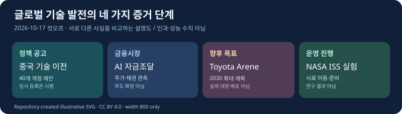

# 글로벌 테크 인텔리전스 리포트 — 2026-10-17

> **원 조사 컷오프:** 2026-10-17 13:39:45 KST / 04:39:45 UTC (정규 오전 08:45 실행 아님). **24시간 조사:** 2026-10-16 13:39:45~2026-10-17 13:39:45 KST. 직전 [2026-10-16 보고서](2026-10-16.md)의 컷오프(10/16 09:03:07 KST)부터 13:39:45까지 **4시간 36분 38초의 별도 공백**을 점검했다. **실제 발행일 2026-10-18**이며 과거 날짜에 발행했다고 표시하지 않는다.
>
> [출처·후보·검증 원장](../../../sources/2026/10/2026-10-17.md) · [자체 설명 도표](../../../assets/2026-10-17/README.md)

*자체 제작 개념도(CC BY 4.0). 항목 간 인과관계나 실제 성능을 측정하지 않는다.*

## 핵심 요약

| 순위 | 새로운 발전 | 분야 | 중요도 / 신뢰도 | 확인 단계 |
|---|---|---|---|---|
| 1 | 중국, AI 관련 23개 등 기술 40개 수출관리 개정안과 임시 등록 | AI·정책 | High / High | 실제 정부 공고·등록 시행 |
| 2 | 미국 AI 관련주 추가 하락·CoreWeave 부채 부담 부각 | 경제·투자 | High / High(지수) | 10/16 주가·채권 시장 |
| 3 | Toyota, 2030년 Arene 연간 1,000만 대 확대 목표 확인 | 로봇·자율주행 | High / Medium-High | 실제 배포가 아닌 회사 목표 |
| 4 | 한국 코스피 10/16 5,668.05(+2.05%) 반등 | 경제·투자 | Medium-High / Medium-High | 실제 거래 마감 |
| 5 | NASA, ISS Dragon 화물 하역·실험 활성화 착수 | 과학·우주 | Medium / High | 실제 작업 진행 |

**핵심 판단:** AI·테크 분야의 경쟁은 모델 성능만 아니라 국경 간 기술 이전 규정, 인프라 자금조달, 소프트웨어의 대규모 실제 배포, 과학 실험의 운영 성과에 영향을 받는다. 서로 다른 증거 단계와 금융시장 위험을 분리한다.

## 01. 중국, AI 등 40개 기술의 수출관리 개정안을 공개

**분야 AI·정책 · High / High · 증거 단계 정부 공고·임시 등록**

### FACT
중국 상무부와 과학기술부는 **2026년 10월 16일 16:00 중국시간(17:00 KST)** 공동 공고 제48호를 공개했다. 수출 금지·제한 기술 목록의 개정 제안 대상은 총 40개 기술로, AI 관련 **23개**, 바이오의약 5개, 태양광 12개다. AI 부문에는 대형 모델, 지능형 에이전트, 연산 클러스터, 정보처리 관련 기술이 포함된다. 이미 오픈소스나 논문 등의 방식으로 공공 영역에 들어온 기술은 관리 범위에서 제외한다고 밝혔다.

**10월 16일~11월 15일**은 개정안 의견수렴 기간이다. 반면 제안된 목록에 해당하는 기술의 국외 소유권 이전이나 해외 라이선스 제공 등에 대한 **수출 전 임시 등록 요건은 공고일부터 적용**한다. 최종 개정안 확정, 임시 등록, 수출 금지는 서로 다른 절차다.

[중국 상무부·과기부 제48호 공식 공고](https://www.mofcom.gov.cn/zcfb/blgg/art/2026/art_1666fcaa24424766afe0683498ff0908.html).

### ANALYSIS
AI 산업의 국제 경쟁과 통제 범위가 반도체 같은 유형 자산을 넘어 모델·소프트웨어·지식재산권 이전의 관리 체계로 확장되는 흐름을 보여준다. 기업은 해외 기술 라이선스·합작사업 등을 준비할 때 실제 적용 범위와 등록 의무를 별도로 검토해야 할 수 있다.

### UNCERTAINTY
- 40개 기술 개정안은 아직 최종 확정되지 않았다. 즉시 적용되는 것은 공고에서 정한 **임시 등록**이다.
- 전체 API 접속이나 공개 모델 사용의 전면 금지를 뜻하지 않는다.
- 최종 시행 세칙·기업별 영향·라이선스 해석은 추가 확인이 필요하다.

### WATCH
11월 15일 의견수렴 종료, 최종 기술 목록·허가 및 등록 절차, 중국 기업의 실제 해외 라이선스 계약 변화.

---

## 02. 미국 AI 주식·CoreWeave 조정으로 자본비용 위험 부각

**분야 경제·투자 · High / High(지수) · 시장·금융 관측 단계**

### FACT
미국 **10월 16일 정규장 최종 마감** 기준 S&P 500은 **7,659.44(약 -1.09%)**, 나스닥 종합은 **26,140.03(약 -2.14%)**, 다우존스 산업평균은 **52,002.41(약 -0.34%)**였다. AP는 각각 **-1.1%, -2.1%, -0.3%**로 반올림해 발표했다. [AP 최종 마감](https://apnews.com/article/wall-street-stocks-dow-nasdaq-c27809783ae3230b44c26e5ee4bea056).

[Reuters의 10월 16일 시장 보도](https://www.reuters.com/business/wall-st-futures-mixed-tech-wobbles-again-tesla-gains-2026-10-16/)에서는 CoreWeave가 약 **12%** 하락하고 5거래일 누적 하락이 약 **25%**에 이른다고 전했다. 채권 수익률도 **15% 이상**으로 보도됐다. 보조 시장데이터의 CoreWeave 정규장 종가는 **$61.39(-11.91%)**였다. [MarketBeat 시세](https://www.marketbeat.com/stocks/NASDAQ/CRWV/news/). Reuters 기사에서 장중 기준 제시된 **-1.22/-2.19/-0.55%**는 AP 최종치와 시점이 달라 확정 마감값으로 사용하지 않는다.

### ANALYSIS
AI 연산 수요가 증가하더라도 GPU·전력설비에 차입금으로 투자하는 데이터센터 운영사는 높은 조달금리, 재융자 위험, 고객 계약의 실제 현금흐름 전환에 영향을 받는다. 전날 [ASML](2026-10-15.md), [TSMC](2026-10-16.md)의 실현 매출은 공급자 수요의 증거지만 AI 인프라 구매자의 수익성을 자동으로 증명하지 않는다.

### UNCERTAINTY
- 주가·채권 수익률은 시장 위험 평가이지 실제 채무불이행 확정이 아니다.
- 금리, 유가, 기존 높은 가치평가와 기업별 이슈 등 복합 요인의 기여를 단일 원인으로 고정하지 않는다.
- AP 최종 종가와 Reuters의 기사 작성 중 지수를 혼용하지 않는다.

### WATCH
CoreWeave 등의 차입금 만기, 신용스프레드, 데이터센터 이용률, 현금흐름, 신규 프로젝트 연기·취소 및 고객 계약의 실제 이행.

---

## 03. Toyota, Arene 소프트웨어 플랫폼 2030년 확대 계획 발표

**분야 로봇·자율주행 / 자동차 소프트웨어 · High / Medium-High · 미래 목표 발표**

### FACT
[Reuters가 10월 16일 07:28 UTC에 보도](https://www.reuters.com/technology/toyota-aims-make-all-its-cars-software-defined-by-2030-nikkei-reports-2026-10-16/)한 바에 따르면 Toyota는 Arene 차량 소프트웨어 플랫폼을 **2030년까지 연간 약 1,000만 대의 신차, 50개 차종**에 적용하려는 목표를 세웠다. Toyota 대변인은 CTO 나카지마 히로키가 지난주 브뤼셀 투자자 설명회에서 관련 배포 계획을 밝혔다고 확인했다. Arene은 2025년 개편 RAV4에 최초 도입됐다. 무선 OTA 업데이트·안전·ADAS·편의 서비스의 공통 개발 기반이다.

이 숫자는 2026년의 실제 탑재 차량 대수가 아닌 **2030년 계획**이다. 당일 새 정량 목표를 담은 Toyota 공식 발표 원문은 확보하지 못했다.

### ANALYSIS
소프트웨어 공통 플랫폼 확장은 차종별 개발 자산의 재사용과 OTA 보안 패치·서비스 제공·안전 개선 속도에 장기적 영향을 줄 수 있다. 하지만 하나의 플랫폼 적용이 모든 차종에서 동일한 자율주행 기능 제공을 의미하지 않는다.

### UNCERTAINTY
- 미래 목표와 실제 배포·안전성 인증 및 고객 이용은 다르다.
- 당일 목표의 직접 확인은 Reuters가 취재한 Toyota 대변인 발언에 의존한다.
- 실제 투자비용 절감·소프트웨어 결함 감소·ADAS 성능은 미검증이다.

### WATCH
차종별 Arene 실제 적용대수, OTA 배포·보안 대응, ADAS 검증 결과 및 차량당 유지관리 비용.

---

## 04. 코스피 5,668.05(+2.05%) 반등, 코스닥도 상승

**분야 경제·투자 · Medium-High / Medium-High · 10/16 장 마감**

### FACT
**2026년 10월 16일** 코스피는 **5,668.05**로 마감해 전일보다 **113.83포인트(+2.05%)** 올랐다. 코스닥은 **794.78**, **+33.96포인트(+4.46%)**였다. 코스피는 이전 7거래일 연속 하락 후 반등했다. [연합뉴스 10/16 15:36 KST 마감 원문](https://www.yna.co.kr/view/AKR20261016121900008) · [Investing.com 보조 시세](https://kr.investing.com/indices/kospi-historical-data).

앞서 사용자에게 제시된 초안의 코스피 **5,668.04를 5,668.05로 정정**했으며, 이 수치 수정에 대한 사용자의 **2026-10-18 재승인**을 받았다.

### ANALYSIS
급락 이후 반등은 위험 선호가 하루 동안 일부 회복됐을 가능성을 시사한다. 그러나 단기 반등과 장기 AI·반도체 수요 전망의 회복은 별개다. 미국 10월 16일 정규장 마감은 한국 같은 날짜 장 종료 뒤에 이루어졌으므로 미국 후속 하락을 한국의 앞선 반등 원인으로 서술하지 않는다.

### UNCERTAINTY
- KRX 최종 종가 원본 파일과 수급 원본은 이번 검증에서 확보하지 못했다.
- 상승 원인을 특정 투자 주체나 발표 하나로 단정하지 않는다.
- 하루의 상승만으로 장기 시장 저점이 확인됐다고 할 수 없다.

### WATCH
10월 19일 한국 시장 개장 후 외국인·기관 수급, 코스피·코스닥 추이, 반도체 실적 전망, 미국 AI 신용시장 위험의 전이 여부.

---

## 05. NASA, ISS에서 Dragon 화물 하역 및 과학실험 활성화 개시

**분야 과학·우주 · Medium / High · 실제 운영 진행**

### FACT
NASA는 **2026년 10월 16일 13:15 미국 동부시간(10월 17일 02:15 KST)** 공식 ISS 블로그에서 10월 15일 도킹한 SpaceX Dragon의 화물을 하역하고 새 연구 시료·장비를 옮기며 과학실험을 활성화하기 시작했다고 알렸다. Dragon은 **6,300파운드 초과**의 과학장비·보급품과 태양전지판을 운송했다.

실험 대상에는 무중력 환경에서 인공 망막, 심장 조직, 단백질 결정, 식물 반응 등이 포함된다. 일부 실험은 금요일과 주말에 순차 가동 예정이다. **신규 사실은 전날 도킹 자체가 아니라 10/16 하역과 실험 준비 진행이다.** [NASA 원문](https://www.nasa.gov/blogs/spacestation/2026/10/16/crew-unpacks-dragon-and-begins-activating-new-science-experiments/).

### ANALYSIS
발사·도킹을 넘어 실제 실험 운영·시료 보존·데이터 획득이라는 후속 단계로 이동했다. 우주사업의 실용성은 운영 단계와 실제 연구 성과를 별도로 확인해야 평가할 수 있다.

### UNCERTAINTY
- 실험 개시·준비가 동료심사 결과나 의료 치료법 개발 완료를 의미하지 않는다.
- 개별 실험의 결과, 재현성·임상 활용 가능성은 현재 미확정이다.

### WATCH
실험별 가동 완료·데이터와 회수 시료, 지상 대조군 비교, 정식 연구 논문, 새 태양전지판 설치 진행.

---

## 분야 간 연결 및 한국·예정 이벤트 점검

중국의 정책은 AI 기술의 **국가 간 이전 실행 조건**, 미국의 AI 관련주 하락은 **자본조달 비용·현금흐름 위험**, Toyota는 **향후 소프트웨어 대량 배포 목표**, NASA는 **실제 우주 운영의 후속 단계**다. 서로 다른 유형의 사건을 직접 인과관계로 연결하지 않고, 실제로 확인된 단계와 아직 필요한 검증을 분리한다.

한국에서는 코스피와 코스닥의 10월 16일 마감값을 국내 보도·보조 시세로 확인했다. 우주항공청 10월 16일 표창 추천자 관련 공지는 신규 핵심 우주기술 성과가 아니므로 제외한다. **KARI·과기정통부·산업통상부·DART·KIND·국내 기업 뉴스룸의 당일 전체 원문을 빠짐없이 재검증하지는 못했다.** 이 점검의 한계는 원장에 적고, 해당 기관에 신규 발표가 없었다고 단정하지 않는다.

예정: 10월 19일 국내 증시 개장, 10월 20일 일본 MMX 발사 계획 후속 검증, 10월 27~28일 미국 FOMC, 11월 15일 중국 수출관리 개정안 의견 마감. 아직 일어나지 않은 결과를 완료로 표기하지 않는다.

## 제외 후보·반복 방지

| 분야 | 후보 | 제외 이유 |
|---|---|---|
| AI·산업 | 독일–NVIDIA 산업 AI 협력 계획 | 신규 서명·실제 산업 배치 근거 미확정, 예정·보도와 실제 실행 구분 |
| 로봇·자율주행 | 런던 로보택시 규제·노동 우려 | 후속 사회적 논쟁으로 새 대규모 운행 실증 미확인 |
| 과학·우주 | NASA 허블 NGC 1827 공개 영상 | 실제 새 소개나 운영 성과의 파급 면에서 ISS 실험보다 후순위 |
| 과학·우주 | JAXA MMX 계획 | 컷오프 당시 발사 완료 근거가 아닌 예정 이벤트 |
| 경제·투자 | 개별 미국 반도체주 연속 하락 | 선정한 AI 금융시장 위험과 중복되는 동일 테마 |
| AI·테크 | 중국 기술 수출관리 | **선정:** 새 정부 공고·등록 절차 |
| 로봇·자율주행 | Toyota Arene | **선정:** 구체적 신규 배포 목표 |
| 경제·투자 | CoreWeave와 미국 지수 | **선정:** 자본비용 위험의 새 시장 관측 |

**누적 추세:** AI 해외 기술 이전·소프트웨어 플랫폼 보급 규모의 신규 공식/취재 증거를 관련 trends에 추가한다. AI 인프라 재무위험은 signals에 새 시장 증거만 반영하고 공급자 실현매출 증가를 부정하지 않는다. NASA 단일 실험 활성화만으로 우주 상용화 신호를 상향하지 않는다.

*본 보고서는 10/17 당시의 조사 내용을 10/18 승인 후 게시했다. 게시 후 실제 원격 검증은 [원장](../../../sources/2026/10/2026-10-17.md)의 완료형 기록으로 관리한다.*
